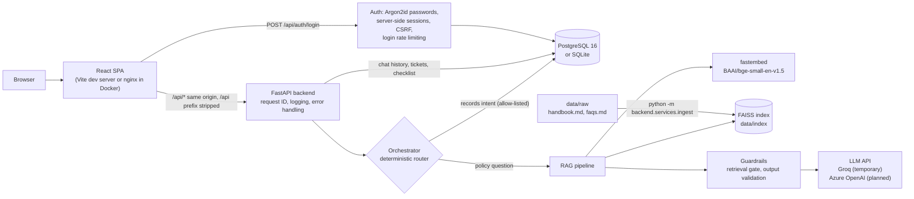

# OnboardAI: RAG-Powered New Joiner Support Platform

OnboardAI helps new employees find onboarding information (leave, payroll, benefits, IT setup, HR policies) without waiting for HR or IT. It answers policy questions from an approved handbook using retrieval-augmented generation (RAG), cites its sources, refuses to guess when the handbook does not contain the answer, and gives each signed-in employee a private workspace for leave balances, assets, an onboarding checklist and support tickets.

EY GDS capstone project - Domain: Generative AI for Human Resources.

> **Data notice:** all content is synthetic. The handbook describes a fictional company (NovaTech Solutions) and the three demo employees (EMP001-EMP003) are fictional. Local email/password authentication protects the demo, but this build has not been security-assessed for real employee data.

## Project status

| Area | Status |
|---|---|
| Backend (FastAPI), RAG (FAISS + fastembed), guardrails | Implemented and tested locally |
| Frontend (React + Vite) | Implemented; browser end-to-end checks passed |
| Persistence | PostgreSQL 16 (primary), SQLite (local fallback and tests) |
| Docker Compose (frontend + backend + PostgreSQL) | Implemented and verified locally |
| LLM provider | **Groq (temporary, development only)** |
| Azure (Azure OpenAI, hosting, identity) | **Not started** - planned final platform, pending Azure access |
| Authentication / authorization | Email + password (Argon2id), server-side sessions, CSRF protection, per-employee authorization, admin role - implemented and tested locally |
| External identity (Microsoft Entra ID / OAuth) | Not implemented (out of scope for now) |

Detailed progress, decisions and test evidence: [docs/project_plan.md](docs/project_plan.md).

## Features

- **AI Assistant** - answers handbook questions with citations (for example `[Handbook 2.1]`), shows only the sources the answer actually cites, and returns a safe fallback with HR/IT contacts when the answer is not in the handbook.
- **Employee-specific answers** - questions such as "What is my leave balance?" are routed to approved database queries (no LLM involved).
- **Secure sign-in** - email and password; each employee sees only their own data; sign out from any page.
- **Chat history** per employee.
- **Onboarding checklist** - 15 tasks per employee; completion is saved.
- **Leave & Payroll** - leave balances and the payroll calendar.
- **My Assets** - assigned IT equipment.
- **Support Center** - create HR/IT/Payroll tickets and view ticket history.

## Architecture



More detail, including the RAG decision flow: [docs/architecture.md](docs/architecture.md).

## Technology stack

| Layer | Technology |
|---|---|
| Frontend | React 19, Vite, axios, lucide-react; nginx (Docker) |
| Backend | Python, FastAPI, Pydantic, Uvicorn |
| Retrieval | fastembed (`BAAI/bge-small-en-v1.5`, local, no API key), FAISS `IndexFlatIP` (cosine) |
| LLM | OpenAI-compatible client against Groq (temporary); Azure OpenAI planned |
| Database | PostgreSQL 16 (psycopg2); SQLite fallback |
| Containers | Docker, Docker Compose |
| Testing | pytest, Node test runner, RAG evaluation script |

## Repository layout

```
backend/            FastAPI app: routes/, services/ (rag, guardrails, retriever, llm, orchestrator, db), middleware/, migrations/ (SQLite)
frontend/           React + Vite app, Dockerfile, nginx.conf
data/raw/           Synthetic handbook, FAQs, checklist (knowledge base)
data/index/         FAISS index (generated, git-ignored)
docker/postgres/    PostgreSQL schema and synthetic seed used by Docker
scripts/            rag_eval.py (RAG evaluation), run_test_questions.py
tests/              unit/ and integration/ pytest suites
docs/               Project plan, architecture, RAG evaluation report, test material
Dockerfile, docker-compose.yml, .dockerignore, .env.example
```

## Configuration

Settings are read from environment variables and the local `.env` file (see `backend/config.py`). Create `.env` from the template and fill in your own values; `.env` is git-ignored and must never be committed.

```powershell
Copy-Item .env.example .env
```

| Variable | Default (code) | Purpose |
|---|---|---|
| `GROQ_API_KEY` | empty | LLM API key (required for chat answers) |
| `GROQ_BASE_URL` | `https://api.groq.com/openai/v1` | OpenAI-compatible LLM endpoint |
| `MODEL_NAME` | `qwen/qwen3.8-27b` | Chat model name |
| `EMBED_MODEL` | `BAAI/bge-small-en-v1.5` | Embedding model (fastembed) |
| `SIMILARITY_THRESHOLD` | `0.65` | Minimum top retrieval score |
| `BORDERLINE_MARGIN` | `0.05` | Band below the threshold that needs keyword corroboration |
| `TOP_K` | `4` | Passages retrieved per question |
| `CHUNK_WORDS` / `CHUNK_OVERLAP_WORDS` | `350` / `40` | Chunking for ingestion |
| `DB_BACKEND` | `sqlite` | `sqlite` or `postgresql` (`.env.example` uses `postgresql`) |
| `DB_PATH` | `data/app.db` | SQLite file |
| `PG_HOST`, `PG_PORT`, `PG_DATABASE`, `PG_USER`, `PG_PASSWORD` | `localhost`, `5432`, `onboardai`, `postgres`, empty | PostgreSQL connection |
| `INDEX_DIR`, `RAW_DIR`, `LOG_DIR` | `data/index`, `data/raw`, `logs` | File locations |
| `DOCKER_PG_PASSWORD` | none (required) | Docker Compose only: password of the container database |
| `BACKEND_PORT`, `FRONTEND_PORT` | `8000`, `8080` | Docker Compose host ports (bound to 127.0.0.1) |
| `APP_ENV` | `development` | `production` disables the development account-provisioning tool |
| `SESSION_TTL_MINUTES` / `SESSION_IDLE_MINUTES` | `480` / `60` | Absolute session lifetime / inactivity timeout |
| `SESSION_COOKIE_SECURE` | `auto` | `auto` sets the cookie `Secure` flag for HTTPS requests; `true` forces it |
| `TRUST_PROXY_HEADERS` | `false` | Use `X-Forwarded-For/-Proto` (only behind a trusted proxy; Docker Compose sets `true`) |
| `LOGIN_MAX_FAILURES_PER_EMAIL` / `LOGIN_MAX_FAILURES_PER_IP` / `LOGIN_WINDOW_SECONDS` | `5` / `20` / `900` | Login rate limiting |
| `PASSWORD_MIN_LENGTH` | `12` | Minimum password length for provisioned accounts |

## Local development (Windows PowerShell)

Prerequisites: Python 3.12+ (verified with 3.12 in Docker and 3.14 locally), Node.js 24, and optionally PostgreSQL 16.

### 1. Backend environment

```powershell
python -m venv .venv
.\.venv\Scripts\Activate.ps1
pip install -r requirements.txt
Copy-Item .env.example .env      # then edit .env locally
```

### 2. Database

**Option A - SQLite (quickest).** Set `DB_BACKEND=sqlite` in `.env`, then create and seed `data/app.db`:

```powershell
python -c "from backend.services import db; db.init_db()"
python backend/migrations/001_employee_schema.py
python backend/migrations/002_seed_demo_data.py
$env:PYTHONPATH = "."; python backend/migrations/003_employee_chat_history.py
python backend/migrations/004_auth_tables.py
```

**Option B - PostgreSQL 16.** Create an empty database (for example `onboardai`), set `DB_BACKEND=postgresql` and the `PG_*` values in `.env`, and load the schema and synthetic seed with `psql -f docker/postgres/01_schema.sql` followed by `psql -f docker/postgres/02_seed.sql`. Then load `docker/postgres/03_auth_schema.sql`. These are the same files Docker uses to initialise its database. For an **existing** PostgreSQL database, add only the authentication tables (additive and idempotent; no existing data is changed): `$env:PYTHONPATH = "."; python backend/migrations/004_auth_tables.py`. The backend refuses to start against PostgreSQL until these tables exist.

**Accounts.** Create sign-in accounts for the synthetic employees (see [Authentication and authorization](#authentication-and-authorization)).

### 3. Knowledge-base index

The FAISS index is generated and git-ignored. Build it once after cloning (this overwrites any existing index in `data/index`):

```powershell
python -m backend.services.ingest     # "Indexed 48 chunks into ...\data\index"
```

### 4. Run

```powershell
python -m uvicorn backend.main:app --reload --port 8000
```

API: http://localhost:8000/health and interactive docs at http://localhost:8000/docs.

In a second terminal:

```powershell
cd frontend
npm ci
npm run dev
```

Open http://localhost:5173. The Vite dev server proxies `/api/*` to `http://127.0.0.1:8000`.

## Docker Compose

Runs three containers: `frontend` (nginx serving the built React app and proxying `/api`), `backend` (FastAPI) and `db` (PostgreSQL 16 with a named volume, seeded from `docker/postgres/` on first start).

Prerequisites: Docker Desktop running, `.env` with your LLM settings, and the FAISS index built in `data/index` (step 3 above) - it is mounted **read-only** into the backend.

```powershell
$env:DOCKER_PG_PASSWORD = "<choose a local value>"   # container database only; do not reuse a real password
docker compose up -d --build --wait
docker compose ps
```

Create accounts in the container database (passwords are entered at a hidden prompt; nothing is created automatically):

```powershell
docker compose exec backend python -m backend.manage_accounts set --email aarav.sharma@example.com --employee-id EMP001
docker compose exec backend python -m backend.manage_accounts list
```

Open http://localhost:8080 and sign in (API also on http://127.0.0.1:8000).

| Task | Command |
|---|---|
| Backend logs | `docker compose logs backend` |
| Stop (keep data) | `docker compose down` |
| Stop and delete the container database and logs | `docker compose down -v` |

Notes:
- The container database is separate from any local PostgreSQL; its port is not published.
- LLM settings come from `.env`; database settings in `docker-compose.yml` override any local `PG_*` values.
- Do not run `docker compose config` without `--quiet` when sharing output: it prints resolved secrets.
- The embedding model is built into the backend image; no secrets are copied into images.

## RAG workflow and guardrails

1. **Ingestion** (`backend/services/ingest.py`): `handbook.md` is split by section headings (350 words, 40 overlap); each FAQ becomes one chunk. Chunks are embedded with fastembed and stored in FAISS with source and section metadata (48 chunks).
2. **Routing** (`orchestrator.py`, `employee_query_router.py`): deterministic precedence rules; personal records (onboarding status, checklist, leave balances, assets, tickets, profile) and the payroll calendar come from approved database functions, policy questions go to RAG, and mixed questions return both parts ("From your records" / "From the handbook") in one saved message. Details: [docs/architecture.md](docs/architecture.md#hybrid-chat-routing-phase-2).
3. **Retrieval** (`retriever.py`): top 4 passages by cosine similarity.
4. **Retrieval gate** (`guardrails.py`): top score >= 0.65 proceeds; 0.60-0.65 proceeds only if a distinctive question keyword appears in the retrieved passages; otherwise the fallback is returned without calling the LLM.
5. **Generation** (`llm.py`): temperature 0; passages are wrapped in `<untrusted_context>` and the system prompt forbids following instructions inside documents, inventing facts, or revealing instructions, keys or credentials. The model replies `NOT_FOUND` when the context is insufficient.
6. **Output validation** (`guardrails.py`): the answer is rejected (fallback returned) if it contains secrets or system-prompt text, has no citation, cites a section that was not retrieved, or states numbers or email addresses absent from the retrieved passages.
7. **Response**: `{message_id, answer, sources, found}`, where `sources` lists only the cited passages (plus `Your records` / `Company records` labels for database parts); each exchange is stored in chat history exactly once.

## Authentication and authorization

**Sign-in.** Employees sign in with their work email and password (`POST /auth/login`). Errors are always the generic "Invalid email or password." whether the email exists or not, and unknown emails still go through an Argon2 verification so timing does not reveal accounts. There is no self-registration or password reset; an administrator provisions accounts.

**Passwords.** Stored only as Argon2id hashes (argon2-cffi defaults: time cost 3, 64 MiB, parallelism 4). Minimum length 12. Never logged, never accepted as command-line arguments.

**Sessions.** A successful login always creates a new server-side session (preventing session fixation). The browser receives a 256-bit random identifier in the `onboardai_session` cookie: `HttpOnly`, `SameSite=Strict`, `Path=/`, and `Secure` automatically on HTTPS (`SESSION_COOKIE_SECURE=auto`). The database stores only a SHA-256 hash of the identifier. Sessions end after 8 hours (absolute) or 60 minutes of inactivity; `POST /auth/logout` deletes the server-side session; changing an account's password or disabling it ends all of its sessions. Nothing is stored in `localStorage` or `sessionStorage`.

**CSRF.** Each session has a random CSRF token, returned by `/auth/login` and `/auth/me` and kept in browser memory. Every authenticated `POST`/`PATCH` must send it in the `X-CSRF-Token` header (403 otherwise). Login itself only accepts `application/json`.

**Brute-force protection.** Failed logins are counted per email (5) and per client IP (20) in a 15-minute sliding window; further attempts get `429` with `Retry-After`, even with the correct password.

**Authorization.** The employee is always taken from the session. Employee IDs in URLs, query strings or bodies are accepted only if they match it (403 otherwise, including unknown IDs, so other employees cannot be enumerated).

| Role | Can access |
|---|---|
| `employee` (linked to one employee ID) | Own profile, leave, assets, checklist (read/update), tickets (read/create), chat and history, feedback on own messages, escalation, payroll calendar |
| `admin` (may have no employee) | `POST /ingest`, legacy `/checklist`, payroll calendar, handbook chat; no employee data unless linked to an employee |

**Provisioning (development only).** Accounts for the synthetic employees are created with a CLI that reads the password from a hidden prompt or a named environment variable, is idempotent, and refuses to run when `APP_ENV=production`:

```powershell
python -m backend.manage_accounts set --email aarav.sharma@example.com --employee-id EMP001
python -m backend.manage_accounts set --email meera.iyer@example.com --employee-id EMP002
python -m backend.manage_accounts set --email rohan.verma@example.com --employee-id EMP003
python -m backend.manage_accounts set --email admin@novatech.example --role admin
python -m backend.manage_accounts list          # emails, roles, links - never hashes
python -m backend.manage_accounts disable --email aarav.sharma@example.com
```

For scripted use, set `$env:ONBOARDAI_NEW_PASSWORD = "<value>"` and add `--password-env ONBOARDAI_NEW_PASSWORD`. Choose a unique password per account; no passwords are stored in the repository.

## API endpoints

All endpoints return JSON; errors use `{"detail": "<message>"}`. Every response carries an `X-Request-ID` header. Access: **Public** = no session; **Session** = signed in; **Own** = the signed-in employee's own records only; **CSRF** = `X-CSRF-Token` header required.

| Method | Path | Access | Purpose |
|---|---|---|---|
| GET | `/health` | Public | Database-aware health check: 200 `{"status":"ok","database":"ok"}`, or 503 when the database is unreachable |
| POST | `/auth/login` | Public, rate-limited | Sign in (`email`, `password`); sets the session cookie |
| GET | `/auth/me` | Session | Current user and CSRF token (restores the session after a refresh) |
| POST | `/auth/logout` | Session + CSRF | Sign out (server-side session deleted) |
| POST | `/chat` | Session + CSRF | Ask a question (`question` max 500 chars; optional `employee_id` must be your own) |
| GET | `/history` | Own | Your chat history (`employee_id` optional and must be your own; `limit` 1-100) |
| GET | `/employees/{employee_id}` | Own | Profile |
| GET | `/employees/{employee_id}/leave-balances` | Own | Leave balances |
| GET | `/employees/{employee_id}/assets` | Own | Assigned assets |
| GET | `/employees/{employee_id}/checklist` | Own | Onboarding checklist |
| PATCH | `/employees/{employee_id}/checklist/{item_id}` | Own + CSRF | Mark a task done / not done |
| GET | `/employees/{employee_id}/tickets` | Own | Support tickets |
| POST | `/employees/{employee_id}/tickets` | Own + CSRF | Create a ticket |
| GET | `/employees/payroll/calendar` | Session | Company payroll calendar |
| GET, PATCH | `/checklist`, `/checklist/{item_id}` | Admin (+ CSRF for PATCH) | Legacy shared checklist |
| POST | `/feedback` | Session + CSRF | Rate an answer (own messages only) |
| POST | `/escalate` | Session + CSRF | Simulated HR/IT escalation |
| POST | `/ingest` | Admin + CSRF | Rebuild the FAISS index |

Error behaviour: 401 without a valid session; 403 for another employee's data, a missing or invalid CSRF token, or a missing role; 429 for too many failed logins; 422 with a readable message for invalid input; 503 for an LLM outage; and a generic 500 with a `request_id` for unexpected failures (stack traces are logged server-side only).

## Testing

| Command | What it covers | Latest verified result |
|---|---|---|
| `python -m pytest -q` | Unit and integration tests (RAG, guardrails, API, error handling, logging, frontend contract, Docker config). Always uses a temporary SQLite database; PostgreSQL connections are blocked in tests. | **145 passed** (21 Nov 2026), including 61 authentication/authorization tests |
| `cd frontend; npm test` | Frontend helper tests (Node test runner) | **7 passed** |
| `cd frontend; npm run lint` | ESLint (React hooks rules) | **0 errors, 0 warnings** |
| `cd frontend; npm run build` | Production build | Succeeded |
| `python -m scripts.rag_eval` | Retrieval, grounding, unknown-question, prompt-injection evaluation; needs `GROQ_API_KEY`, else LLM cases are reported NOT TESTED. Rewrites `docs/rag_eval_report.md`. `--no-llm` runs deterministic checks only. | **50/50 passed** (20 Nov 2026, live Groq) |

Additional checks performed during development (scripts not in the repository): browser end-to-end tests in headless Chrome (16/16 against both the Vite dev server and the Docker stack), Docker integration, restart and persistence checks (18/18 and 4/4), workflow and failure-case sweeps. Step 10 re-ran all of them on 21 Nov 2026, including a live RAG evaluation (50/50). See [docs/final_local_test_report.md](docs/final_local_test_report.md). After authentication was added (21 Nov 2026): browser sign-in/workspace checks 13/13 on both the Docker stack and the Vite dev server, Docker auth checks through nginx 20/20 (including live Groq chat after sign-in), and sessions/accounts persisted across backend restart and full down/up (3/3 each).

## Logging and security notes

- Logs go to the console and `logs/app.log` (rotating), formatted `time | LEVEL | rid=<request id> | message`. Question text, API keys, passwords, session identifiers and CSRF tokens are not logged; failed logins are logged with a short one-way fingerprint of the email, not the email itself.
- Secrets are supplied only through `.env` or environment variables; `.env` is excluded from git and Docker build contexts.
- Every endpoint except `/health` and `/auth/login` requires a session; employees can only reach their own records; `POST /ingest` requires the admin role. See [Authentication and authorization](#authentication-and-authorization).

## Planned migration to Azure OpenAI (not implemented)

Groq is used temporarily because Azure access is not yet available. The planned migration, once access is granted:

1. Provision an Azure OpenAI resource and a chat model deployment in an approved region.
2. Point the existing OpenAI-compatible client to Azure: either use Azure OpenAI's OpenAI-compatible endpoint through the existing base URL / key / model settings, or add a small provider switch in `backend/services/llm.py` for the Azure endpoint, API version and deployment name. Rename the Groq-specific variables accordingly.
3. Store keys in Azure Key Vault or use managed identity instead of `.env`.
4. Re-run `python -m pytest -q` and `python -m scripts.rag_eval`; re-validate `SIMILARITY_THRESHOLD`, `BORDERLINE_MARGIN` and `NOT_FOUND` behaviour with the new model.
5. Decide hosting, managed PostgreSQL and HTTPS before any non-local deployment; decide later whether to keep local accounts or move to an external identity provider (for example Microsoft Entra ID).

## Known limitations

- Groq is a temporary provider; no Azure resources exist yet.
- Authentication is local email/password only: no MFA, no password reset or self-service password change, no external identity provider, no admin UI (admin actions are API-only).
- Login rate limiting is held in process memory: it resets on restart and is not shared across multiple backend processes; a locked email blocks that account for up to 15 minutes (possible nuisance lockout). In Docker the backend port 8000 is also published on localhost while `X-Forwarded-For` is trusted, so a local client could bypass the per-IP limit (the per-email limit still applies).
- Synthetic, single-company knowledge base (48 chunks); retrieval misses some paraphrased questions (documented in the RAG report).
- Grounding checks are lexical; paraphrased unsupported claims without numbers or emails can pass.
- PostgreSQL schema is provided as a snapshot (`docker/postgres/`); migrations in `backend/migrations/` target SQLite only.
- `requirements.txt` is unpinned and includes test tools; no HTTPS; no CI pipeline configured yet (`.github/workflows/` is empty); no load tests yet (`tests/load/` is empty).
- API docs (`/docs`, `/openapi.json`) are publicly reachable; nginx sends no security headers.

## Documentation

- [docs/project_plan.md](docs/project_plan.md) - milestones, step-by-step progress, test evidence, risks
- [docs/final_local_test_report.md](docs/final_local_test_report.md) - final local test results, known issues, Azure prerequisites
- [docs/runbook.md](docs/runbook.md) - start/stop, health checks, logs, troubleshooting
- [docs/demo_script.md](docs/demo_script.md) - 10-minute demonstration walkthrough
- [docs/architecture.md](docs/architecture.md) - architecture and RAG flow
- [docs/rag_eval_report.md](docs/rag_eval_report.md) - latest RAG evaluation output
- [docs/problem_statement.md](docs/problem_statement.md) - capstone problem statement
- [frontend/README.md](frontend/README.md) - frontend notes

## Author

Eliksha Maheshwari - sole developer (architecture, backend, AI, frontend, DevOps, QA, documentation).
