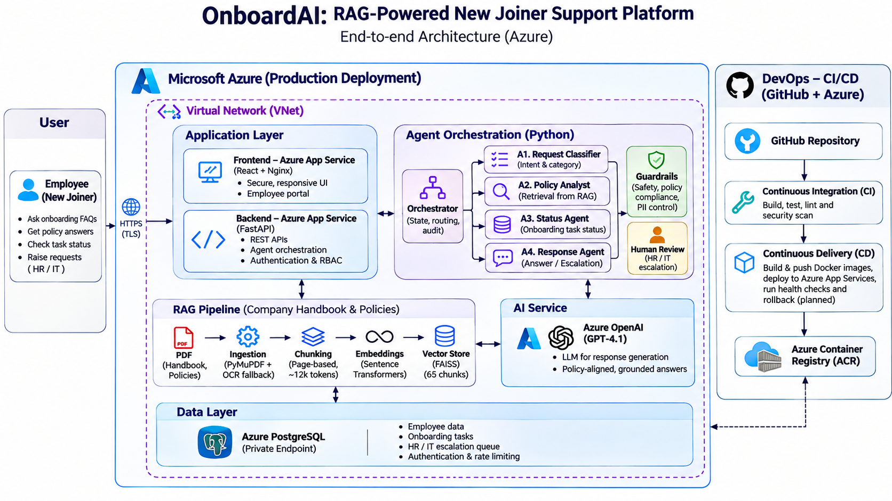
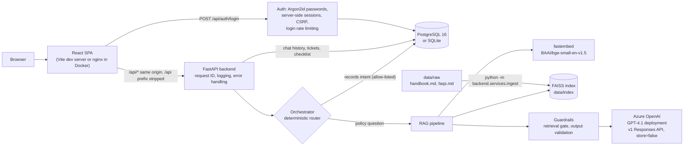

# OnboardAI: RAG-Powered New Joiner Support Platform

OnboardAI helps new employees find onboarding information (leave, payroll, benefits, IT setup, HR policies) without waiting for HR or IT. It answers policy questions from an approved handbook using retrieval-augmented generation (RAG), cites its sources, refuses to guess when the handbook does not contain the answer, and gives each signed-in employee a private workspace for leave balances, assets, an onboarding checklist and support tickets.

EY GDS capstone project - Domain: Generative AI for Human Resources.

> **Data notice:** all content is synthetic. The handbook describes a fictional company (NovaTech Solutions) and the three demo employees (EMP001-EMP003) are fictional. Local email/password authentication protects the demo, but this build has not been security-assessed for real employee data.

## Project status

| Area | Status |
|---|---|
| Backend (FastAPI), RAG (FAISS + fastembed), guardrails | Implemented and tested locally |
| Frontend (React + Vite) | Implemented; browser end-to-end checks passed |
| Persistence | PostgreSQL 16 (primary), SQLite (local fallback and tests) |
| Docker Compose (frontend + backend + PostgreSQL) | Implemented and verified locally |
| LLM provider | **Azure OpenAI, GPT-4.1 deployment** (OpenAI v1 Responses API, `store=false`) |
| Azure deployment | **Deployed and verified (25 Nov 2026)** - App Service (frontend public, backend behind a private endpoint), private PostgreSQL Flexible Server 16, Azure Container Registry, Azure OpenAI; production verification 17/17 passed. See [Azure deployment](#azure-deployment) |
| Authentication / authorization | Email + password (Argon2id), server-side sessions, CSRF protection, per-employee authorization, admin role - implemented and tested locally |
| External identity (Microsoft Entra ID / OAuth) | Not implemented (out of scope for now) |
| Continuous integration (GitHub Actions) | Implemented: backend, live PostgreSQL security suite, frontend and Docker build jobs on every push and pull request |
| Continuous delivery (GitHub Actions) | **Implemented, not yet executed** (`.github/workflows/cd.yml`: manual, main only, CI-gated, approval environment, OIDC, scan, deploy, verify, automatic rollback). Operational after its first successful release |

Detailed progress, decisions and test evidence: [docs/project_plan.md](docs/project_plan.md).

## Features

- **AI Assistant** - answers handbook questions with citations (for example `[Handbook 2.1]`), shows only the sources the answer actually cites, and returns a safe fallback with HR/IT contacts when the answer is not in the handbook.
- **Employee-specific answers** - questions such as "What is my leave balance?" are routed to approved database queries (no LLM involved).
- **Secure sign-in** - email and password; each employee sees only their own data; sign out from any page.
- **Chat history** per employee.
- **Feedback and escalation from chat** - rate any answer (Helpful / Not helpful) or escalate it to HR/IT in one click; the escalation records who escalated which answer (M5).
- **Onboarding checklist** - 15 tasks per employee; completion is saved.
- **Leave & Payroll** - leave balances and the payroll calendar.
- **My Assets** - assigned IT equipment.
- **Support Center** - create HR/IT/Payroll tickets and view ticket history.

## Architecture



*Conceptual overview. Exact network isolation, RAG implementation and CI/CD details: [docs/architecture.md](docs/architecture.md).*

Application request flow:



More detail, including the RAG decision flow and the deployed Azure network diagram: [docs/architecture.md](docs/architecture.md).

## Technology stack

| Layer | Technology |
|---|---|
| Frontend | React 19, Vite, axios, lucide-react; nginx (Docker) |
| Backend | Python, FastAPI, Pydantic, Uvicorn |
| Retrieval | fastembed (`BAAI/bge-small-en-v1.5`, local, no API key), FAISS `IndexFlatIP` (cosine) |
| LLM | Azure OpenAI GPT-4.1 deployment through the OpenAI Python SDK (v1 Responses API, API key, `store=false`) |
| Database | PostgreSQL 16 (psycopg2); SQLite fallback |
| Containers | Docker, Docker Compose |
| Testing | pytest, Node test runner, locust (load test), RAG and held-out hybrid evaluation scripts, GitHub Actions CI |

## Repository layout

```
backend/            FastAPI app: routes/, services/ (rag, guardrails, retriever, llm, orchestrator, db), middleware/,
                    migrations/ (001-004 SQLite/auth tables, 005-008 PostgreSQL roles, integrity, HR queue)
frontend/           React + Vite app, Dockerfile, nginx.conf (local Docker)
deploy/azure/       Azure deployment scripts (PowerShell, dry run by default), Azure Dockerfiles, nginx template, migration tooling
data/raw/           Synthetic handbook (PDF canonical, Markdown copy), FAQs, checklist (knowledge base)
data/csv/           Synthetic HR reference data for the CSV importer (matches the seed)
data/index/         Versioned FAISS index: versions/<id>/ + ACTIVE pointer (generated, git-ignored)
docker/postgres/    PostgreSQL schema and synthetic seed used by Docker
scripts/            rag_eval.py, hybrid_eval.py (evaluation), import_csv.py (CSV import), schema_dictionary.py (schema check), run_test_questions.py
tests/              unit/ and integration/ pytest suites, eval/ (held-out dataset), load/ (locust load test)
.github/workflows/  ci.yml (tests, security suite, frontend, Docker build), cd.yml (approval-gated release to Azure)
docs/               Project plan, architecture, runbook, evaluation and test reports (dated; earlier ones used Groq)
Dockerfile, docker-compose.yml, .dockerignore, .env.example
```

## Configuration

Settings are read from environment variables and the local `.env` file (see `backend/config.py`). Create `.env` from the template and fill in your own values; `.env` is git-ignored and must never be committed.

```powershell
Copy-Item .env.example .env
```

| Variable | Default (code) | Purpose |
|---|---|---|
| `AZURE_OPENAI_ENDPOINT` | empty | Azure resource v1 endpoint, e.g. `https://<resource>.services.ai.azure.com/openai/v1` (bare resource URL accepted; `AZURE_OPENAI_BASE_URL` is an alias) |
| `AZURE_OPENAI_DEPLOYMENT` | empty | Azure deployment name (`gpt-4.1`) |
| `AZURE_OPENAI_API_KEY` | empty | API key; required for chat answers (missing configuration -> 503, no request sent) |
| `LLM_TIMEOUT_SECONDS` / `LLM_MAX_RETRIES` / `LLM_MAX_OUTPUT_TOKENS` | `30` / `2` / `600` | Request timeout, SDK retries, answer length limit |
| `EMBED_MODEL` | `BAAI/bge-small-en-v1.5` | Embedding model (fastembed) |
| `SIMILARITY_THRESHOLD` | `0.65` | Minimum top retrieval score |
| `BORDERLINE_MARGIN` | `0.05` | Band below the threshold that needs keyword corroboration |
| `TOP_K` | `4` | Passages retrieved per question |
| `CHUNK_WORDS` / `CHUNK_OVERLAP_WORDS` | `350` / `40` | Chunking for ingestion |
| `DB_BACKEND` | `sqlite` | `sqlite` or `postgresql` (`.env.example` uses `postgresql`) |
| `DB_PATH` | `data/app.db` | SQLite file |
| `PG_HOST`, `PG_PORT`, `PG_DATABASE`, `PG_USER`, `PG_PASSWORD` | `localhost`, `5432`, `onboardai`, `postgres`, empty | PostgreSQL connection |
| `INDEX_DIR`, `RAW_DIR`, `LOG_DIR` | `data/index`, `data/raw`, `logs` | File locations |
| `DOCKER_PG_PASSWORD` | none (required) | Docker Compose only: password of the container database |
| `BACKEND_PORT`, `FRONTEND_PORT` | `8000`, `8080` | Docker Compose host ports (bound to 127.0.0.1) |
| `APP_ENV` | `development` | `production` disables the development account-provisioning tool |
| `SESSION_TTL_MINUTES` / `SESSION_IDLE_MINUTES` | `480` / `60` | Absolute session lifetime / inactivity timeout |
| `SESSION_COOKIE_SECURE` | `auto` | `auto` sets the cookie `Secure` flag for HTTPS requests; `true` forces it |
| `TRUST_PROXY_HEADERS` | `false` | Use `X-Forwarded-For/-Proto` (only behind a trusted proxy; Docker Compose sets `true`) |
| `LOGIN_MAX_FAILURES_PER_EMAIL` / `LOGIN_MAX_FAILURES_PER_IP` / `LOGIN_WINDOW_SECONDS` | `5` / `20` / `900` | Login rate limiting |
| `PASSWORD_MIN_LENGTH` | `12` | Minimum password length for provisioned accounts |
| `LOGIN_RATE_LIMIT_BACKEND` / `LOGIN_RATE_LIMIT_MAX_KEYS` | `auto` / `10000` | Rate-limit store: `auto` = shared `login_failures` table on PostgreSQL, process memory on SQLite (`memory` / `database` force one) |
| `PG_READER_USER`, `PG_READER_PASSWORD`, `PG_SCOPE_SECRET` | empty | Least-privilege reader role and employee-scope signing secret (migration 005) |
| `PG_SSLMODE` / `PG_SSLROOTCERT` | `prefer` / empty | PostgreSQL TLS (Azure: `verify-full` with the CA bundle in the image) |
| `PG_STATEMENT_TIMEOUT_MS`, `SQL_AGENT_MAX_ROWS`, `SQL_AGENT_STATEMENT_TIMEOUT_MS` | see `.env.example` | Database statement limits |
| `PG_POOL_ENABLED`, `PG_POOL_MAX_SIZE`, `PG_POOL_TIMEOUT_SECONDS`, `PG_POOL_MAX_LIFETIME_SECONDS`, `PG_POOL_VALIDATE_IDLE_SECONDS` | see `.env.example` | PostgreSQL connection pool |
| `BACKEND_PROXY_SECRET` / `TRUSTED_PROXY_HOPS` | empty / `1` | Azure: shared key the frontend proxy adds (backend rejects requests without it) / proxy hops trusted for the client IP |
| `API_DOCS` | unset = only when `APP_ENV=development` | `false` hides `/docs`, `/redoc` and `/openapi.json` |

`.env.example` lists every setting with a safe default or a placeholder; secrets are never committed.

## Local development (Windows PowerShell)

Prerequisites: Python 3.12+ (verified with 3.12 in Docker and 3.14 locally), Node.js 24, and optionally PostgreSQL 16.

### 1. Backend environment

```powershell
python -m venv .venv
.\.venv\Scripts\Activate.ps1
pip install -r requirements-dev.txt   # pinned runtime + test tools (the Docker image uses requirements.txt only)
Copy-Item .env.example .env      # then edit .env locally
```

### 2. Database

**Option A - SQLite (quickest).** Set `DB_BACKEND=sqlite` in `.env`, then create and seed `data/app.db`:

```powershell
python -c "from backend.services import db; db.init_db()"
python backend/migrations/001_employee_schema.py
python backend/migrations/002_seed_demo_data.py
$env:PYTHONPATH = "."; python backend/migrations/003_employee_chat_history.py
python backend/migrations/004_auth_tables.py
```

**Option B - PostgreSQL 16.** Create an empty database (for example `onboardai`), set `DB_BACKEND=postgresql` and the `PG_*` values in `.env`, and load the schema and synthetic seed with `psql -f docker/postgres/01_schema.sql` followed by `psql -f docker/postgres/02_seed.sql`. Then load `docker/postgres/03_auth_schema.sql`. These are the same files Docker uses to initialise its database. For an **existing** PostgreSQL database, add only the authentication tables (additive and idempotent; no existing data is changed): `$env:PYTHONPATH = "."; python backend/migrations/004_auth_tables.py`. The backend refuses to start against PostgreSQL until these tables exist.

**Accounts.** Create sign-in accounts for the synthetic employees (see [Authentication and authorization](#authentication-and-authorization)).

### 3. Knowledge-base index

The FAISS index is generated and git-ignored. Build it once after cloning (this overwrites any existing index in `data/index`):

```powershell
python -m backend.services.ingest     # "Indexed 48 chunks into ...\data\index"
```

### 4. Run

```powershell
python -m uvicorn backend.main:app --reload --port 8000
```

API: http://localhost:8000/health and interactive docs at http://localhost:8000/docs.

In a second terminal:

```powershell
cd frontend
npm ci
npm run dev
```

Open http://localhost:5173. The Vite dev server proxies `/api/*` to `http://127.0.0.1:8000`.

## Docker Compose

Runs three containers: `frontend` (nginx serving the built React app and proxying `/api`), `backend` (FastAPI) and `db` (PostgreSQL 16 with a named volume, seeded from `docker/postgres/` on first start).

Prerequisites: Docker Desktop running, `.env` with your LLM settings, and the FAISS index built in `data/index` (step 3 above) - it is mounted **read-only** into the backend.

```powershell
$env:DOCKER_PG_PASSWORD = "<choose a local value>"   # container database only; do not reuse a real password
docker compose up -d --build --wait
docker compose ps
```

The backend **refuses to start as the database owner** (a superuser) - it needs the least-privilege roles. On a new database, start only `db`, provision the roles once with migration 005 (`docker compose run --rm --no-deps ... backend python backend/migrations/005_least_privilege_roles.py --apply`, runbook section 9), keep the role passwords and scope secret in a secrets file outside the repository, and start the stack with `docker compose --env-file <secrets file> up -d --build --wait`. Migrations and `manage_accounts` are unaffected (they run as separate commands).

Create accounts in the container database (passwords are entered at a hidden prompt; nothing is created automatically):

```powershell
docker compose exec backend python -m backend.manage_accounts set --email aarav.sharma@example.com --employee-id EMP001
docker compose exec backend python -m backend.manage_accounts list
```

Open http://localhost:8080 and sign in (API also on http://127.0.0.1:8000).

| Task | Command |
|---|---|
| Backend logs | `docker compose logs backend` |
| Stop (keep data) | `docker compose down` |
| Stop and delete the container database and logs | `docker compose down -v` |

Notes:
- The container database is separate from any local PostgreSQL; its port is not published.
- LLM settings come from `.env`; database settings in `docker-compose.yml` override any local `PG_*` values.
- Do not run `docker compose config` without `--quiet` when sharing output: it prints resolved secrets.
- The embedding model is built into the backend image; no secrets are copied into images.

## RAG workflow and guardrails

1. **Ingestion** (`backend/services/ingest.py`): `handbook.pdf` is the canonical source (the same-stem `handbook.md` is a derived copy and is skipped). Text is extracted per page, split at numbered section headings and into overlapping 2-sentence retrieval windows whose context is the whole section; each FAQ becomes one chunk. Chunks are embedded with fastembed and written to a versioned, validated FAISS index activated atomically (current index: 65 chunks - 40 handbook, 25 FAQ). Citations carry the section and page.
2. **Routing** (`orchestrator.py`, `employee_query_router.py`): deterministic precedence rules; personal records (onboarding status, checklist, leave balances, assets, tickets, profile) and the payroll calendar come from approved database functions, policy questions go to RAG, and mixed questions return both parts ("From your records" / "From the handbook") in one saved message. Details: [docs/architecture.md](docs/architecture.md#hybrid-chat-routing-phase-2).
3. **Retrieval** (`retriever.py`): top 4 passages by cosine similarity.
4. **Retrieval gate** (`guardrails.py`): top score >= 0.65 proceeds; 0.60-0.65 proceeds only if a distinctive question keyword appears in the retrieved passages; otherwise the fallback is returned without calling the LLM.
5. **Generation** (`llm.py`): temperature 0; passages are wrapped in `<untrusted_context>` and the system prompt forbids following instructions inside documents, inventing facts, or revealing instructions, keys or credentials. The model replies `NOT_FOUND` when the context is insufficient.
6. **Output validation** (`guardrails.py`): the answer is rejected (fallback returned) if it contains secrets or system-prompt text, has no citation, cites a section that was not retrieved, or states numbers or email addresses absent from the retrieved passages.
7. **Response**: `{message_id, answer, sources, found}`, where `sources` lists only the cited passages (plus `Your records` / `Company records` labels for database parts); each exchange is stored in chat history exactly once.

## Authentication and authorization

**Sign-in.** Employees sign in with their work email and password (`POST /auth/login`). Errors are always the generic "Invalid email or password." whether the email exists or not, and unknown emails still go through an Argon2 verification so timing does not reveal accounts. There is no self-registration or password reset; an administrator provisions accounts.

**Passwords.** Stored only as Argon2id hashes (argon2-cffi defaults: time cost 3, 64 MiB, parallelism 4). Minimum length 12. Never logged, never accepted as command-line arguments.

**Sessions.** A successful login always creates a new server-side session (preventing session fixation). The browser receives a 256-bit random identifier in the `onboardai_session` cookie: `HttpOnly`, `SameSite=Strict`, `Path=/`, and `Secure` automatically on HTTPS (`SESSION_COOKIE_SECURE=auto`). The database stores only a SHA-256 hash of the identifier. Sessions end after 8 hours (absolute) or 60 minutes of inactivity; `POST /auth/logout` deletes the server-side session; changing an account's password or disabling it ends all of its sessions. Nothing is stored in `localStorage` or `sessionStorage`.

**CSRF.** Each session has a random CSRF token, returned by `/auth/login` and `/auth/me` and kept in browser memory. Every authenticated `POST`/`PATCH` must send it in the `X-CSRF-Token` header (403 otherwise). Login itself only accepts `application/json`.

**Brute-force protection.** Failed logins are counted per email (5) and per client IP (20) in a 15-minute sliding window; further attempts get `429` with `Retry-After`, even with the correct password. On PostgreSQL (Docker and Azure) the counters live in the shared `login_failures` table (migration 008), so they survive restarts and apply across workers; on SQLite they are kept in process memory.

**Authorization.** The employee is always taken from the session. Employee IDs in URLs, query strings or bodies are accepted only if they match it (403 otherwise, including unknown IDs, so other employees cannot be enumerated).

| Role | Can access |
|---|---|
| `employee` (linked to one employee ID) | Own profile, leave, assets, checklist (read/update), tickets (read/create), chat and history, feedback on own messages, escalation, payroll calendar |
| `admin` (may have no employee) | `POST /ingest`, legacy `/checklist`, payroll calendar, handbook chat; no employee data unless linked to an employee |
| `hr` (HR/IT support staff, not linked to an employee) | HR/IT escalation queue (`/hr/escalations`): list, view, change status with a note (audit trail) |

**Provisioning (development only).** Accounts for the synthetic employees are created with a CLI that reads the password from a hidden prompt or a named environment variable, is idempotent, and refuses to run when `APP_ENV=production`:

```powershell
python -m backend.manage_accounts set --email aarav.sharma@example.com --employee-id EMP001
python -m backend.manage_accounts set --email meera.iyer@example.com --employee-id EMP002
python -m backend.manage_accounts set --email rohan.verma@example.com --employee-id EMP003
python -m backend.manage_accounts set --email admin@novatech.example --role admin
python -m backend.manage_accounts set --email hr@novatech.example --role hr
python -m backend.manage_accounts list          # emails, roles, links - never hashes
python -m backend.manage_accounts disable --email aarav.sharma@example.com
```

For scripted use, set `$env:ONBOARDAI_NEW_PASSWORD = "<value>"` and add `--password-env ONBOARDAI_NEW_PASSWORD`. Choose a unique password per account; no passwords are stored in the repository.

## API endpoints

All endpoints return JSON; errors use `{"detail": "<message>"}`. Every response carries an `X-Request-ID` header. Access: **Public** = no session; **Session** = signed in; **Own** = the signed-in employee's own records only; **CSRF** = `X-CSRF-Token` header required.

| Method | Path | Access | Purpose |
|---|---|---|---|
| GET | `/health` | Public | Database-aware health check: 200 `{"status":"ok","database":"ok"}`, or 503 when the database is unreachable |
| GET | `/ready` | Internal (not proxied by nginx) | Readiness: database, schema/migrations, FAISS index, embedding model, configuration; 200 or 503 (App Service health check) |
| POST | `/auth/login` | Public, rate-limited | Sign in (`email`, `password`); sets the session cookie |
| GET | `/auth/me` | Session | Current user and CSRF token (restores the session after a refresh) |
| POST | `/auth/logout` | Session + CSRF | Sign out (server-side session deleted) |
| POST | `/chat` | Session + CSRF | Ask a question (`question` max 500 chars; optional `employee_id` must be your own) |
| GET | `/history` | Own | Your chat history (`employee_id` optional and must be your own; `limit` 1-100) |
| GET | `/employees/{employee_id}` | Own | Profile |
| GET | `/employees/{employee_id}/leave-balances` | Own | Leave balances |
| GET | `/employees/{employee_id}/assets` | Own | Assigned assets |
| GET | `/employees/{employee_id}/checklist` | Own | Onboarding checklist |
| PATCH | `/employees/{employee_id}/checklist/{item_id}` | Own + CSRF | Mark a task done / not done |
| GET | `/employees/{employee_id}/tickets` | Own | Support tickets |
| POST | `/employees/{employee_id}/tickets` | Own + CSRF | Create a ticket |
| GET | `/employees/payroll/calendar` | Session | Company payroll calendar |
| GET, PATCH | `/checklist`, `/checklist/{item_id}` | Admin (+ CSRF for PATCH) | Legacy shared checklist |
| POST | `/feedback` | Session + CSRF | Rate an answer (own messages only) |
| POST | `/escalate` | Session + CSRF | Escalate an own answer to the HR/IT queue |
| GET | `/hr/escalations`, `/hr/escalations/{escalation_id}` | HR role | Escalation queue and details |
| PATCH | `/hr/escalations/{escalation_id}` | HR role + CSRF | Change status (allowed transitions only) with an optional note |
| POST | `/ingest` | Admin + CSRF | Rebuild the FAISS index |

Error behaviour: 401 without a valid session; 403 for another employee's data, a missing or invalid CSRF token, or a missing role; 429 for too many failed logins; 422 with a readable message for invalid input; 503 for an LLM outage; and a generic 500 with a `request_id` for unexpected failures (stack traces are logged server-side only).

## Testing

Install the pinned development tools first: `pip install -r requirements-dev.txt` (runtime dependencies are in `requirements.txt`, which is all the Docker image installs).

| Command | What it covers | Latest verified result |
|---|---|---|
| `python -m pytest -q` | Unit and integration tests (routing, orchestration, RAG, guardrails, auth, isolation, API, error handling, logging, frontend contract, Docker config, evaluation dataset, CSV import, PDF index, feedback/escalation, security headers). Always uses a temporary SQLite database; PostgreSQL connections are blocked. The real-embedding retrieval tests need the FAISS index (`python -m backend.services.ingest`). | **711 passed** (Python 3.12 Docker test image, 25 Nov 2026, including 10 static security checks of the CD workflow; the 133 live-PostgreSQL tests are skipped without a disposable server and run in the next row and in CI) |
| `ONBOARDAI_PG_TEST_ADMIN_DSN=... python -m pytest tests/integration/test_postgres_roles.py tests/integration/test_postgres_m4.py tests/integration/test_postgres_m5.py tests/integration/test_postgres_m6.py` | Live PostgreSQL roles, RLS, signed scope, isolation attacks, import role, CSV import, schema dictionary, migrations 007 and 008 (HR queue, shared rate limiting) against a **disposable** local server | **133 passed** (24 Nov 2026) |
| `cd frontend; npm test` / `npm run lint` / `npm run build` | Frontend helper tests, ESLint, production build | **11 passed** / 0 problems / built (M5) |
| `python -m scripts.hybrid_eval --routing-only` | Held-out routing accuracy (62 questions, deterministic; also a CI regression floor) | **62/62** (M4; 60/62 in M3) |
| `python -m scripts.hybrid_eval --report docs/azure_eval_report.md` | Held-out end-to-end evaluation: routing, records correctness, refusals, retrieval, grounding, citations, mixed answers, fallbacks, latency by route kind | **Azure OpenAI GPT-4.1 (24 Nov 2026): every quality metric 62/62, 30/30 or 10/10**, retrieval MRR 0.978 ([docs/azure_eval_report.md](docs/azure_eval_report.md)). Historical M4 run with Groq: [docs/hybrid_eval_report.md](docs/hybrid_eval_report.md) |
| `python -m scripts.import_csv data/csv` / `python -m scripts.schema_dictionary --check` | CSV import dry run (see runbook section 10) / schema dictionary vs a database | - |
| `bash tests/load/run_isolated_load_test.sh` | Small load test (locust) against a throw-away stack with least-privilege roles; `WITH_EVAL=1` also runs the HTTP evaluation | See [docs/load_test_report.md](docs/load_test_report.md) |
| `python -m scripts.rag_eval` | Retrieval, grounding, unknown-question, prompt-injection evaluation; needs the Azure OpenAI settings, else LLM cases are reported NOT TESTED. Rewrites `docs/rag_eval_report.md`. `--no-llm` runs deterministic checks only. | **50/50 passed** (Azure OpenAI GPT-4.1, 24 Nov 2026; retrieval MRR 0.971) |

**Continuous integration** (`.github/workflows/ci.yml`, on pushes to `dev`/`main`, pull requests and manual runs): backend tests on Python 3.12 with the index built from `data/raw` and a no-skip check; the live PostgreSQL security suite against a disposable `postgres:16-alpine` container with a per-job random password; frontend test/lint/build on Node 24; Docker image builds with smoke checks (pip check, import, no dev tools in the image, non-root user) and `docker compose config`. No deployment, no image push, no real secrets (the LLM is mocked). Latest runs: #7 (`df18ffd`, Azure deployment) and #8 (`6427fd7`, submission cleanup), all jobs passed. Continuous delivery (`cd.yml`) is a separate, manual workflow that requires such a successful CI run for the release commit on `main`; it is implemented but not yet executed.

**Production verification on Azure** (`deploy/azure/70-Verify-Deployment.ps1`, 25 Nov 2026): **17/17 passed** (8 public, 9 signed-in), grounded GPT-4.1 answer citing handbook.pdf page 3 in 4232 ms. See [Azure deployment](#azure-deployment).

Historical checks performed during local development with the earlier Groq provider (scripts not in the repository) (scripts not in the repository): browser end-to-end tests in headless Chrome (16/16 against both the Vite dev server and the Docker stack), Docker integration, restart and persistence checks (18/18 and 4/4), workflow and failure-case sweeps. Step 10 re-ran all of them on 21 Nov 2026, including a live RAG evaluation (50/50). See [docs/final_local_test_report.md](docs/final_local_test_report.md). After authentication was added (21 Nov 2026): browser sign-in/workspace checks 13/13 on both the Docker stack and the Vite dev server, Docker auth checks through nginx 20/20 (including live Groq chat after sign-in), and sessions/accounts persisted across backend restart and full down/up (3/3 each).

## Logging and security notes

- Logs go to the console and `logs/app.log` (rotating), formatted `time | LEVEL | rid=<request id> | message`. Question text, API keys, passwords, session identifiers and CSRF tokens are not logged; failed logins are logged with a short one-way fingerprint of the email, not the email itself.
- Secrets are supplied only through `.env` or environment variables; `.env` is excluded from git and Docker build contexts.
- Production (Azure): only the frontend is public; the backend is reachable only through a private endpoint (public network access disabled); PostgreSQL is VNet-injected with no public access, TLS certificate verification and least-privilege roles with row-level security; SCM/FTP basic authentication is disabled; images are pulled with managed identities. Details: [Azure deployment](#azure-deployment) and [docs/architecture.md](docs/architecture.md#deployment-view-azure).
- Every endpoint except `/health` and `/auth/login` requires a session; employees can only reach their own records; `POST /ingest` requires the admin role. See [Authentication and authorization](#authentication-and-authorization).

## Azure OpenAI (implemented)

Azure OpenAI is the only LLM provider (Groq has been removed). `backend/services/llm.py` uses the OpenAI Python SDK against the resource's v1 endpoint with the Responses API: `model` = the deployment name (`gpt-4.1`), the grounded system prompt as `instructions`, the retrieved passages wrapped as untrusted context in `input`, `temperature=0`, `store=false`; no dated `api-version` is needed. Missing or invalid configuration fails closed (503, no request); provider errors are logged with type and HTTP status only; a content-filtered prompt or an incomplete response produces the standard fallback. Instructions aimed at the assistant inside retrieved text (indirect prompt injection) are removed before the prompt is built, keeping the rest of the policy passage. Evaluation results: `docs/azure_eval_report.md`, `docs/rag_eval_report.md`. Setup and activation: runbook section 13.

## Azure deployment

Deployed on 25 November 2026 to Azure (South India) with the PowerShell scripts in [deploy/azure/](deploy/azure/README.md) (dry run by default, existing resources reused, no secrets in the repository).

| Component | Deployed configuration |
|---|---|
| Frontend | Linux Web App (nginx + React build), the only public endpoint: HTTPS only, TLS 1.2+, security headers, `/api/*` proxied to the backend |
| Backend | Linux Web App (FastAPI, FAISS index and embedding model in the image); **public network access disabled**, reachable only through a private endpoint (private DNS `privatelink.azurewebsites.net`) |
| Network | VNet with an App Service integration subnet (both apps, route all), a private-endpoint subnet and a delegated PostgreSQL subnet |
| Database | Azure Database for PostgreSQL Flexible Server 16, VNet-injected, public access disabled, no firewall rules, TLS required and verified; app uses the least-privilege `onboardai_app` / `onboardai_reader` roles with row-level security |
| Images | Azure Container Registry (admin user disabled), pulled with system-assigned managed identities |
| LLM | Azure OpenAI GPT-4.1 deployment (Responses API, `store=false`) |
| Hardening | SCM/FTP basic authentication disabled on both apps, FTPS disabled, health checks `/ready` and `/healthz`; database administrator password rotated after migration |

**Production verification** (`deploy/azure/70-Verify-Deployment.ps1`): 17/17 passed - 8 public checks (health, HSTS/CSP/X-Frame-Options/nosniff, API docs and readiness hidden, sign-in required, generic login error, backend not usable directly) and 9 signed-in checks (secure session cookie, own profile and checklist, other employees' data refused, grounded GPT-4.1 answer citing handbook.pdf page 3 in 4232 ms against a 5000 ms target, out-of-scope fallback, history, sign-out). Migration and deployment evidence: [docs/project_plan.md](docs/project_plan.md).

**Continuous delivery** (`.github/workflows/cd.yml`, implemented 25 Nov 2026, **not yet executed**): a manual run on `main` with confirmation, only for a commit whose CI passed, rebuilds and validates the FAISS index, builds both production images, scans them separately for vulnerabilities (fixable HIGH/CRITICAL block) and secrets (any secret blocks), and - after approval in the protected GitHub environment `production` - signs in to Azure with GitHub OIDC as a dedicated managed identity (`AcrPush` on the registry, `Website Contributor` on the two Web Apps only; no stored credential), pushes immutable tags (commit SHA + run id + attempt), deploys backend then frontend, verifies health (`/api/health` HTTP 200 with healthy JSON), unchanged configuration and the 8 public checks, and - if a production update was attempted and anything fails - rolls both apps back automatically and verifies the previous images, configuration and health. Database migrations stay manual. Details: [deploy/azure/README.md, section 8](deploy/azure/README.md#8-continuous-delivery-github-actions).

Remaining Azure improvements (not implemented):

1. Move secrets from App Service app settings to Azure Key Vault references, and use managed identity / Entra ID authentication for Azure OpenAI and PostgreSQL instead of keys and passwords.
2. First execution of the continuous-delivery workflow (implemented; see below). Deployment slots / blue-green releases would need a Standard or higher App Service plan.
3. Re-validate `SIMILARITY_THRESHOLD`, `BORDERLINE_MARGIN` and `NOT_FOUND` behaviour periodically with real questions.
4. Decide later whether to keep local accounts or move to an external identity provider (for example Microsoft Entra ID).

## Known limitations

- Azure deployment is a single instance on a Basic (B1) App Service plan (no deployment slots, so a release restarts the apps briefly); continuous delivery is implemented but not yet executed; secrets are App Service app settings (no Key Vault yet); no WAF in front of the public frontend.
- Authentication is local email/password only: no MFA, no password reset or self-service password change, no external identity provider, no admin UI (admin actions are API-only).
- Login rate limiting is shared in PostgreSQL (`login_failures`, migration 008) but held in process memory on the SQLite fallback; a locked email blocks that account for up to 15 minutes (possible nuisance lockout). In Docker the backend port 8000 is also published on localhost while `X-Forwarded-For` is trusted, so a local client could bypass the per-IP limit (the per-email limit still applies).
- Synthetic, single-company knowledge base (48 chunks); retrieval misses some paraphrased questions (documented in the RAG report).
- Grounding checks are lexical; paraphrased unsupported claims without numbers or emails can pass.
- The base PostgreSQL schema is provided as a snapshot (`docker/postgres/`); later PostgreSQL changes are idempotent migration scripts (005-008) run manually, not a migration framework.
- Direct dependencies are pinned (`requirements.txt`, `requirements-dev.txt`); transitive dependencies are not locked. HTTPS is provided by Azure App Service; the local Docker stack is HTTP on localhost only.
- The load test is a small smoke-level run (10 users, 60 s, records questions only); see [docs/load_test_report.md](docs/load_test_report.md).
- The five M3 held-out evaluation failures were fixed in M4 (see [docs/hybrid_eval_report.md](docs/hybrid_eval_report.md)); the router remains rule-based, so unusual phrasings can still fall back to the handbook.
- CSV import is a manual CLI (no upload UI); dates are still stored as text; the import role must be provisioned (migration 006) before importing into PostgreSQL.
- API documentation is served only in development (`APP_ENV=development`; `API_DOCS=false` in Docker) and nginx blocks `/api/docs`; nginx sends CSP and related security headers (M5). The CSP is self-only (fonts are bundled) except inline styles (`style-src 'unsafe-inline'`, needed by React style attributes).
- Escalations go to an HR/IT queue (`/hr/escalations`, `hr` role, audit trail) that is API-only (no HR user interface) and are not delivered by email or a ticketing system; feedback has no reviewer UI.

## Documentation

- [docs/project_plan.md](docs/project_plan.md) - milestones, step-by-step progress, test evidence, risks
- [docs/final_local_test_report.md](docs/final_local_test_report.md) - final local test results, known issues, Azure prerequisites
- [docs/runbook.md](docs/runbook.md) - start/stop, health checks, logs, troubleshooting
- [deploy/azure/README.md](deploy/azure/README.md) - Azure deployment runbook (scripts, order, migration, verification, rollback)
- [docs/demo_script.md](docs/demo_script.md) - 10-minute demonstration walkthrough
- [docs/architecture.md](docs/architecture.md) - architecture and RAG flow
- [docs/rag_eval_report.md](docs/rag_eval_report.md) - latest RAG evaluation output
- [docs/hybrid_eval_report.md](docs/hybrid_eval_report.md) - held-out hybrid chat evaluation (routing, records, grounding, citations, latency)
- [docs/load_test_report.md](docs/load_test_report.md) - load test environment and results
- [docs/problem_statement.md](docs/problem_statement.md) - capstone problem statement
- [frontend/README.md](frontend/README.md) - frontend notes

## Author

Eliksha Maheshwari - sole developer (architecture, backend, AI, frontend, DevOps, QA, documentation).
