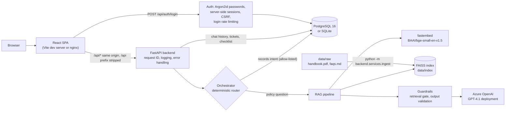

# OnboardAI: RAG-Powered New Joiner Support Platform

OnboardAI helps new employees find onboarding information - leave, payroll, benefits, IT setup and HR policies - without waiting for HR or IT.

- Answers policy questions from an approved handbook using retrieval-augmented generation (RAG) and cites its sources.
- Refuses to guess when the handbook does not contain the answer.
- Gives each signed-in employee a private workspace: leave balances, assets, onboarding checklist and support tickets.
- EY GDS capstone project - Domain: Generative AI for Human Resources.

> **Data notice:** all content is synthetic. The handbook describes a fictional company (NovaTech Solutions) and the demo employees (EMP001-EMP003) are fictional. The application has not been security-assessed for real employee data.

**Live application (Azure):** https://onboardai-eliksha-frontend-e4ehc5caahajdshh.southindia-01.azurewebsites.net

- Sign-in required; accounts are provisioned by an administrator (no self-registration).

## Contents

- [Results at a glance](#results-at-a-glance)
- [Project status](#project-status)
- [Features](#features)
- [Scope](#scope)
- [Architecture](#architecture)
- [Technology stack](#technology-stack)
- [Repository layout](#repository-layout)
- [Configuration](#configuration)
- [Local development](#local-development-windows-powershell)
- [Docker Compose](#docker-compose)
- [Operations runbook](#operations-runbook)
- [RAG workflow and guardrails](#rag-workflow-and-guardrails)
- [Security](#security)
- [API endpoints](#api-endpoints)
- [Testing](#testing)
- [Azure deployment](#azure-deployment)
- [CI/CD](#cicd)
- [Known limitations](#known-limitations)
- [Documentation](#documentation)
- [Author](#author)

## Results at a glance

- **Production verification on Azure** (`70-Verify-Deployment.ps1`, 8 public + 9 signed-in checks per run):
  - First release: 17/17; grounded GPT-4.1 answer citing handbook.pdf page 3 in 4232 ms (target < 5000 ms).
  - CD-deployed release, 3 runs: **50/51** assertions (98.04%) - public 24/24, signed-in 26/27, every functional check passed.
  - Grounded-answer latency 5086 / 2135 / 1752 ms (median 2135 ms, mean 2991 ms); the single failed assertion was the first run exceeding the 5000 ms target by 86 ms. Typical response time is below 5 s; the sample is small.
- **Continuous delivery:** a verified production release built, scanned and deployed both images through the approval-gated pipeline; deployed digests verified, configuration unchanged, 8/8 public checks.
- **RAG evaluation (GPT-4.1):** 50/50 - index 6, retrieval 17, grounding 17, unknown questions 7, prompt injection 3; retrieval MRR 0.971.
- **Held-out hybrid evaluation (62 questions, GPT-4.1):** routing 62/62, records answers 26/26, grounded handbook answers 30/30, mixed answers 10/10, unauthorized refused 8/8, out-of-scope fallback 6/6.
- **Automated tests:** backend 718 passed; live PostgreSQL security suite 133 passed; frontend 11 passed; CI green on `main`.
- **Database migration to Azure:** 12/12 table fingerprints identical over TLS 1.3 inside the virtual network.
- **Image security:** Trivy reports 0 fixable HIGH/CRITICAL vulnerabilities and 0 secrets in both production images.

## Project status

- **Backend** (FastAPI), RAG (FAISS + fastembed) and guardrails - implemented, tested, deployed on Azure.
- **Frontend** (React + Vite, served by nginx) - implemented, deployed on Azure.
- **Persistence** - PostgreSQL 16 (primary); SQLite for local fallback and tests.
- **LLM provider** - Azure OpenAI, GPT-4.1 deployment.
- **Docker Compose** (frontend + backend + PostgreSQL) - implemented and verified locally.
- **Azure deployment** - deployed and verified: App Service (public frontend, private backend), private PostgreSQL Flexible Server 16, Azure Container Registry, Azure OpenAI.
- **Authentication and authorization** - email + password (Argon2id), server-side sessions, CSRF protection, per-employee authorization, `admin` and `hr` roles.
- **Continuous integration** - GitHub Actions on every push and pull request; required on `main` by branch protection.
- **Continuous delivery** - operational; production releases are **manually triggered and require reviewer approval** (no automatic Azure deployments).
- **External identity** (Microsoft Entra ID / OAuth) - not implemented.

## Features

- **AI Assistant** - answers handbook questions with citations (for example `[Handbook 2.1]`), shows only the sources the answer cites, and returns a safe fallback with HR/IT contacts when the handbook has no answer.
- **Employee-specific answers** - "What is my leave balance?" is answered from approved database queries (no LLM involved).
- **Mixed questions** - "How much casual leave do I have left, and how far in advance must I apply?" returns both parts ("From your records" / "From the handbook") in one answer.
- **Safety** - refuses questions about other employees, answers out-of-scope questions with a safe fallback, and resists prompt injection.
- **Secure sign-in** - each employee sees only their own data; sign out from any page.
- **Chat history** per employee.
- **Feedback and escalation** - rate answers (Helpful / Not helpful) or escalate one to an HR/IT queue with status transitions and an audit trail.
- **Onboarding checklist** - 15 tasks per employee; completion is saved.
- **Leave & Payroll** - leave balances and the payroll calendar.
- **My Assets** - assigned IT equipment.
- **Support Center** - create HR/IT/Payroll tickets and view ticket history.

## Scope

- **Primary users:** new joiners in their first 90 days.
- **Secondary users:** HR and IT support teams (content owners, escalation receivers).
- **Out of scope:**
  - Single sign-on and external identity providers (local email/password sign-in is provided)
  - HRMS or email integration
  - Admin upload page
  - Multilingual support
  - Analytics
  - Automated approvals
  - Legal/medical interpretation
  - Real employee data

## Architecture


- Conceptual overview; exact network isolation, RAG implementation and CI/CD details are in [docs/architecture.md](docs/architecture.md).

Application request flow:



## Technology stack

- **Frontend:** React 19, Vite, axios, lucide-react; nginx.
- **Backend:** Python, FastAPI, Pydantic, Uvicorn.
- **Retrieval:** fastembed (`BAAI/bge-small-en-v1.5`, local, no API key); FAISS `IndexFlatIP` (cosine).
- **LLM:** Azure OpenAI GPT-4.1 through the OpenAI Python SDK (v1 Responses API, `store=false`).
- **Database:** PostgreSQL 16 (psycopg2); SQLite fallback.
- **Containers:** Docker and Docker Compose (local); production images from `deploy/azure/*.Dockerfile`.
- **Azure:** App Service (Linux, sitecontainers) x2, Azure Database for PostgreSQL Flexible Server 16 (VNet-injected), Virtual Network with private endpoint and private DNS, Azure Container Registry, Azure OpenAI, managed identities.
- **Testing:** pytest, Node test runner, locust, RAG and held-out hybrid evaluation scripts.
- **CI/CD:** GitHub Actions - CI on every push and pull request; manual, approval-gated CD to Azure with OIDC and Trivy image scanning.

## Repository layout

```
backend/            FastAPI app: routes/, services/ (rag, guardrails, retriever, llm, orchestrator, db), middleware/,
                    migrations/ (001-004 SQLite/auth tables, 005-008 PostgreSQL roles, integrity, HR queue)
frontend/           React + Vite app, Dockerfile, nginx.conf (local Docker)
deploy/azure/       Azure deployment scripts (PowerShell, dry run by default), Azure Dockerfiles, CD helper, migration tooling
data/raw/           Synthetic handbook (PDF canonical, Markdown copy), FAQs, checklist (knowledge base)
data/csv/           Synthetic HR reference data for the CSV importer
data/index/         Versioned FAISS index: versions/<id>/ + ACTIVE pointer (generated, git-ignored)
docker/postgres/    PostgreSQL schema and synthetic seed used by Docker
scripts/            rag_eval.py, hybrid_eval.py (evaluation), import_csv.py, schema_dictionary.py, run_test_questions.py
tests/              unit/ and integration/ pytest suites, eval/ (held-out dataset), load/ (locust load test)
.github/workflows/  ci.yml (tests, security suite, frontend, Docker build), cd.yml (approval-gated release to Azure)
docs/               Architecture, runbook, project plan, problem statement, load test and test reports
Dockerfile, docker-compose.yml, .dockerignore, .env.example
```

## Configuration

- Settings come from environment variables and the local `.env` file (`backend/config.py`).
- Create `.env` from the template; `.env` is git-ignored and must never be committed:

  ```powershell
  Copy-Item .env.example .env
  ```

- `.env.example` lists every setting with a safe default or a placeholder.
- **Azure OpenAI**
  - `AZURE_OPENAI_ENDPOINT` - resource v1 endpoint, e.g. `https://<resource>.services.ai.azure.com/openai/v1` (`AZURE_OPENAI_BASE_URL` is an alias).
  - `AZURE_OPENAI_DEPLOYMENT` - deployment name (`gpt-4.1`).
  - `AZURE_OPENAI_API_KEY` - required for chat answers (missing configuration returns 503; no request is sent).
  - `LLM_TIMEOUT_SECONDS` / `LLM_MAX_RETRIES` / `LLM_MAX_OUTPUT_TOKENS` - `30` / `2` / `600`.
- **Retrieval**
  - `EMBED_MODEL` - `BAAI/bge-small-en-v1.5`.
  - `SIMILARITY_THRESHOLD` - `0.65`; `BORDERLINE_MARGIN` - `0.05`; `TOP_K` - `4`.
  - `CHUNK_WORDS` / `CHUNK_OVERLAP_WORDS` - `350` / `40`.
- **Database**
  - `DB_BACKEND` - `sqlite` or `postgresql` (`.env.example` uses `postgresql`); `DB_PATH` - `data/app.db`.
  - `PG_HOST`, `PG_PORT`, `PG_DATABASE`, `PG_USER`, `PG_PASSWORD` - defaults `localhost`, `5432`, `onboardai`, `postgres`, empty.
  - `PG_READER_USER`, `PG_READER_PASSWORD`, `PG_SCOPE_SECRET` - least-privilege reader role and employee-scope signing secret (migration 005).
  - `PG_SSLMODE` / `PG_SSLROOTCERT` - `prefer` / empty (Azure: `verify-full` with the CA bundle in the image).
  - `PG_STATEMENT_TIMEOUT_MS`, `SQL_AGENT_MAX_ROWS`, `SQL_AGENT_STATEMENT_TIMEOUT_MS` - statement limits.
  - `PG_POOL_ENABLED`, `PG_POOL_MAX_SIZE`, `PG_POOL_TIMEOUT_SECONDS`, `PG_POOL_MAX_LIFETIME_SECONDS`, `PG_POOL_VALIDATE_IDLE_SECONDS` - connection pool.
- **Sessions and sign-in**
  - `APP_ENV` - `development`; `production` disables the account-provisioning tool.
  - `SESSION_TTL_MINUTES` / `SESSION_IDLE_MINUTES` - `480` / `60`; `SESSION_COOKIE_SECURE` - `auto`.
  - `LOGIN_MAX_FAILURES_PER_EMAIL` / `LOGIN_MAX_FAILURES_PER_IP` / `LOGIN_WINDOW_SECONDS` - `5` / `20` / `900`.
  - `LOGIN_RATE_LIMIT_BACKEND` / `LOGIN_RATE_LIMIT_MAX_KEYS` - `auto` / `10000` (shared `login_failures` table on PostgreSQL, process memory on SQLite).
  - `PASSWORD_MIN_LENGTH` - `12`.
- **Proxy and API**
  - `TRUST_PROXY_HEADERS` - `false` (Docker Compose sets `true`); `TRUSTED_PROXY_HOPS` - `1`.
  - `BACKEND_PROXY_SECRET` - Azure: shared key the frontend proxy adds; the backend rejects requests without it.
  - `API_DOCS` - unset means docs only when `APP_ENV=development`.
- **Files and Docker**
  - `INDEX_DIR`, `RAW_DIR`, `LOG_DIR` - `data/index`, `data/raw`, `logs`.
  - `DOCKER_PG_PASSWORD` - Docker Compose only (required); `BACKEND_PORT`, `FRONTEND_PORT` - `8000`, `8080` (bound to 127.0.0.1).

## Local development (Windows PowerShell)

- **Prerequisites:** Python 3.12+, Node.js 24, optionally PostgreSQL 16.
- **1. Backend environment**

  ```powershell
  python -m venv .venv
  .\.venv\Scripts\Activate.ps1
  pip install -r requirements-dev.txt   # pinned runtime + test tools
  Copy-Item .env.example .env           # then edit .env locally
  ```

- **2. Database - option A, SQLite (quickest):** set `DB_BACKEND=sqlite` in `.env`, then:

  ```powershell
  python -c "from backend.services import db; db.init_db()"
  python backend/migrations/001_employee_schema.py
  python backend/migrations/002_seed_demo_data.py
  $env:PYTHONPATH = "."; python backend/migrations/003_employee_chat_history.py
  python backend/migrations/004_auth_tables.py
  ```

- **2. Database - option B, PostgreSQL 16:**
  - Create an empty database (for example `onboardai`), set `DB_BACKEND=postgresql` and the `PG_*` values.
  - Load `docker/postgres/01_schema.sql`, `02_seed.sql` and `03_auth_schema.sql` with `psql -f`.
  - For an existing database add only the authentication tables: `$env:PYTHONPATH = "."; python backend/migrations/004_auth_tables.py`.
- **3. Knowledge-base index** (generated, git-ignored; build once after cloning):

  ```powershell
  python -m backend.services.ingest     # "Indexed 65 chunks into ...\data\index"
  ```

- **4. Run**

  ```powershell
  python -m uvicorn backend.main:app --reload --port 8000
  # second terminal
  cd frontend
  npm ci
  npm run dev
  ```

  - API: http://localhost:8000/health (interactive docs at http://localhost:8000/docs in development).
  - App: http://localhost:5173 (the Vite dev server proxies `/api/*` to `http://127.0.0.1:8000`).
- **5. Accounts:** see [Operations runbook](#operations-runbook).

## Docker Compose

- Runs `frontend` (nginx + React build, proxies `/api`), `backend` (FastAPI) and `db` (PostgreSQL 16, named volume, seeded from `docker/postgres/` on first start).
- **Prerequisites:** Docker Desktop running, `.env` with the LLM settings, FAISS index built (it is mounted read-only).
- **Start:**

  ```powershell
  $env:DOCKER_PG_PASSWORD = "<choose a local value>"   # container database only; never reuse a real password
  docker compose up -d --build --wait
  docker compose ps
  ```

- **Least-privilege start:** the backend refuses to connect as the database owner.
  - On a new database start only `db`, provision the roles once with migration 005 (`... backend python backend/migrations/005_least_privilege_roles.py --apply`; see [docs/runbook.md](docs/runbook.md#9-database-roles-least-privilege)).
  - Keep the role passwords and scope secret in a secrets file outside the repository and start with `docker compose --env-file <secrets file> up -d --build --wait`.
- Open http://localhost:8080 and sign in.
- Do not run `docker compose config` without `--quiet` when sharing output - it prints resolved secrets.

## Operations runbook

All commands are PowerShell from the project root. Full details: [docs/runbook.md](docs/runbook.md).

- **Start and stop**
  - Local: activate `.\.venv\Scripts\Activate.ps1`; backend `python -m uvicorn backend.main:app --reload --port 8000`; frontend `cd frontend; npm run dev`; stop with `Ctrl+C`.
  - Docker: set `$env:DOCKER_PG_PASSWORD` in each new shell; `docker compose up -d --build --wait`; `docker compose ps`; `docker compose restart backend`.
  - Stop and keep data: `docker compose down`. Stop and **delete** the container database and logs: `docker compose down -v`.
  - Experiments: use a separate project name, e.g. `docker compose -p onboardai-test up -d --build --wait` and `docker compose -p onboardai-test down -v`.
- **Accounts** (never created automatically; passwords via hidden prompt, minimum 12 characters)
  - Employee: `python -m backend.manage_accounts set --email aarav.sharma@example.com --employee-id EMP001`
  - Administrator: `python -m backend.manage_accounts set --email admin@novatech.example --role admin`
  - HR/IT queue: `python -m backend.manage_accounts set --email hr@novatech.example --role hr`
  - List (no secrets): `python -m backend.manage_accounts list`; disable (ends its sessions): `python -m backend.manage_accounts disable --email <email>`
  - Docker: prefix with `docker compose exec backend`; for scripted use set `$env:ONBOARDAI_NEW_PASSWORD` and add `--password-env ONBOARDAI_NEW_PASSWORD`.
  - Re-running `set` with a new password resets it and signs the account out everywhere.
- **Health checks**
  - `curl http://localhost:8000/health` and `curl http://localhost:8080/api/health` - expect HTTP 200 `{"status":"ok","database":"ok"}`.
  - `curl http://localhost:8080/api/employees/EMP001` - expect 401 when not signed in.
  - `docker compose ps` - `db`, `backend`, `frontend` all `(healthy)`.
  - `/health` is database-aware (`SELECT 1`, 3-second timeout) and returns 503 when the database is unreachable.
- **Logs and request tracing**
  - Local `logs/app.log` (rotating) and console; Docker `docker compose logs backend`.
  - Format `time | LEVEL | rid=<request id> | message`; every response has `X-Request-ID`, and 500 responses include the same `request_id` - search the log for it.
  - Questions, API keys, passwords, session identifiers and CSRF tokens are never logged.
- **Common problems**
  - 503 "AI service temporarily unavailable" - check the `AZURE_OPENAI_*` settings; search the log for `LLM unavailable:`.
  - 500 on employee pages - database down; find the `request_id`, then `docker compose ps db` / `docker compose start db`.
  - `required variable DOCKER_PG_PASSWORD is missing a value` - set it in the current shell.
  - Seed changes not applied - init scripts run only on an empty volume: `docker compose down -v`, then `up`.
  - Chat 500 with a FAISS error - build the index with `python -m backend.services.ingest` before `docker compose up`.
  - 429 "Too many failed sign-in attempts" - wait for `Retry-After`.
  - Backend refuses to start: "Authentication tables are missing" - run migration 004.
- **Data and index**
  - Rebuild the index only after changing `data/raw`: `python -m backend.services.ingest` (new validated version, atomic activation, previous version kept on failure).
  - CSV import dry run: `python -m scripts.import_csv data/csv` (dedicated import role, migration 006).
- **Backups:** `pg_dump -Fc` from the `db` container, copied out with `docker compose cp`, SHA-256 recorded; never redirect binary dumps with `>` or `|` in Windows PowerShell 5.1; restore only into a disposable server (see the runbook).
- **Safety rules**
  - Never commit `.env` or secrets files; never put passwords in files, scripts or chat.
  - Keep local ports bound to `127.0.0.1`; use synthetic data only.
  - The backend must not connect as a PostgreSQL superuser outside local development.
  - Database migrations (local or Azure) change live data - get approval first; on Azure they run only through the manual in-VNet procedure.

## RAG workflow and guardrails

1. **Ingestion** (`backend/services/ingest.py`) - `handbook.pdf` is canonical; text is extracted per page, split at numbered section headings into overlapping 2-sentence retrieval windows with section context; each FAQ is one chunk; 65 chunks in a versioned, validated FAISS index with atomic activation; citations carry section and page.
2. **Routing** (`orchestrator.py`, `employee_query_router.py`) - deterministic rules: personal records and the payroll calendar from approved database functions, policy questions to RAG, mixed questions answered in both parts.
3. **Retrieval** (`retriever.py`) - top 4 passages by cosine similarity.
4. **Retrieval gate** (`guardrails.py`) - score >= 0.65 proceeds; 0.60-0.65 only with a distinctive keyword match; otherwise the fallback is returned without calling the LLM.
5. **Generation** (`llm.py`) - temperature 0; passages wrapped as untrusted context; instructions inside retrieved text are screened out; the model answers `NOT_FOUND` when the context is insufficient.
6. **Output validation** (`guardrails.py`) - rejects answers with secrets or system-prompt text, missing or invalid citations, or numbers/emails not in the retrieved passages.
7. **Response** - `{message_id, answer, sources, found}`; only cited sources are returned; each exchange is saved once.

## Security

- **Sign-in:** generic "Invalid email or password." for every failure; unknown emails still run an Argon2 verification (no timing leak); no self-registration.
- **Passwords:** Argon2id hashes only; minimum 12 characters; never logged or passed as command-line arguments.
- **Sessions:** new server-side session per login; 256-bit identifier in an `HttpOnly`, `SameSite=Strict` cookie (`Secure` on HTTPS); only its SHA-256 hash is stored; 8 h absolute / 60 min idle; logout and password changes end sessions.
- **CSRF:** every authenticated `POST`/`PATCH` requires the session's `X-CSRF-Token`.
- **Brute-force protection:** 5 failures per email and 20 per client IP in 15 minutes -> `429` with `Retry-After`; counters shared in PostgreSQL.
- **Authorization:** identity always comes from the session; other employees' IDs return 403.
- **Roles:**
  - `employee` - own profile, leave, assets, checklist, tickets, chat and history, feedback, escalation, payroll calendar.
  - `admin` - `POST /ingest`, legacy `/checklist`, payroll calendar, handbook chat; no employee data unless linked.
  - `hr` - HR/IT escalation queue (`/hr/escalations`): list, view, change status with a note.
- **Database:** least-privilege `onboardai_app` and `onboardai_reader` roles; row-level security bound to an HMAC-signed employee scope; allow-listed read queries only.
- **Web:** nginx sends HSTS, a self-only CSP, `X-Frame-Options: DENY` and `nosniff`; API documentation is not public in production.
- **Production network:** only the frontend is public; the backend is reachable only through a private endpoint; PostgreSQL has no public access and requires verified TLS; SCM/FTP basic authentication is disabled; images are pulled with managed identities.

## API endpoints

- All endpoints return JSON; errors use `{"detail": "<message>"}`; every response carries `X-Request-ID`.
- Access: **Public** = no session; **Session** = signed in; **Own** = own records only; **CSRF** = `X-CSRF-Token` required.

| Method | Path | Access | Purpose |
|---|---|---|---|
| GET | `/health` | Public | Database-aware health check (200 or 503) |
| GET | `/ready` | Internal | Readiness of database, schema, index, embedding model and configuration (App Service health check) |
| POST | `/auth/login` | Public, rate-limited | Sign in; sets the session cookie |
| GET | `/auth/me` | Session | Current user and CSRF token |
| POST | `/auth/logout` | Session + CSRF | Sign out |
| POST | `/chat` | Session + CSRF | Ask a question (max 500 characters) |
| GET | `/history` | Own | Chat history |
| GET | `/employees/{employee_id}` | Own | Profile |
| GET | `/employees/{employee_id}/leave-balances` | Own | Leave balances |
| GET | `/employees/{employee_id}/assets` | Own | Assigned assets |
| GET | `/employees/{employee_id}/checklist` | Own | Onboarding checklist |
| PATCH | `/employees/{employee_id}/checklist/{item_id}` | Own + CSRF | Mark a task done / not done |
| GET | `/employees/{employee_id}/tickets` | Own | Support tickets |
| POST | `/employees/{employee_id}/tickets` | Own + CSRF | Create a ticket |
| GET | `/employees/payroll/calendar` | Session | Payroll calendar |
| GET, PATCH | `/checklist`, `/checklist/{item_id}` | Admin (+ CSRF) | Legacy shared checklist |
| POST | `/feedback` | Session + CSRF | Rate an answer |
| POST | `/escalate` | Session + CSRF | Escalate an answer to the HR/IT queue |
| GET | `/hr/escalations`, `/hr/escalations/{escalation_id}` | HR role | Escalation queue and details |
| PATCH | `/hr/escalations/{escalation_id}` | HR role + CSRF | Change status with an optional note |
| POST | `/ingest` | Admin + CSRF | Rebuild the FAISS index |

- Error behaviour: 401 without a session; 403 for other employees' data, missing CSRF token or role; 429 for too many failed logins; 422 for invalid input; 503 for an LLM outage; generic 500 with a `request_id` for unexpected failures.

## Testing

- Install the pinned tools first: `pip install -r requirements-dev.txt`.
- **Backend:** `python -m pytest -q` - unit and integration tests on a temporary SQLite database (PostgreSQL blocked); needs the FAISS index. Result: **718 passed**.
- **Live PostgreSQL security suite:** `ONBOARDAI_PG_TEST_ADMIN_DSN=... python -m pytest tests/integration/test_postgres_roles.py tests/integration/test_postgres_m4.py tests/integration/test_postgres_m5.py tests/integration/test_postgres_m6.py` against a **disposable** server - roles, RLS, signed scope, isolation attacks, import role, migrations 007/008. Result: **133 passed**.
- **Frontend:** `cd frontend; npm test` / `npm run lint` / `npm run build`. Result: **11 passed**, 0 lint problems, build OK.
- **Routing evaluation:** `python -m scripts.hybrid_eval --routing-only` - 62 held-out questions. Result: **62/62**.
- **End-to-end held-out evaluation:** `python -m scripts.hybrid_eval --report <output file>` - routing, records, refusals, retrieval, grounding, citations, mixed answers, fallbacks, latency. GPT-4.1 result: all quality metrics 62/62, 30/30 or 10/10; retrieval MRR 0.978.
- **RAG evaluation:** `python -m scripts.rag_eval` (needs Azure OpenAI settings; `--no-llm` runs deterministic checks only). GPT-4.1 result: **50/50**.
- **Load test:** `bash tests/load/run_isolated_load_test.sh` - see [docs/load_test_report.md](docs/load_test_report.md) (287 requests, 0 failures).
- **CSV import / schema dictionary:** `python -m scripts.import_csv data/csv` / `python -m scripts.schema_dictionary --check`.
- **Production verification:** `deploy/azure/70-Verify-Deployment.ps1` - 8 public checks (health, security headers, hidden docs, sign-in required, generic login error, backend not directly reachable) and 9 signed-in checks (secure cookie, own data, other employees refused, grounded GPT-4.1 answer with citation, fallback, history, sign-out). Results: first release **17/17**; CD-deployed release **50/51** over 3 runs (one latency assertion at 5086 ms; all functional checks passed).

## Azure deployment

- **Region:** South India; deployed with PowerShell scripts in [deploy/azure/](deploy/azure/README.md) (dry run by default, existing resources reused, no secrets in the repository).
- **Frontend Web App** (Linux) - the only public endpoint; HTTPS only, TLS 1.2+, security headers; proxies `/api/*` to the backend.
- **Backend Web App** (Linux) - FastAPI with the FAISS index and embedding model in the image; **public network access disabled**; reachable only through a private endpoint with private DNS (`privatelink.azurewebsites.net`).
- **Virtual network** - App Service integration subnet (both apps, route all), private-endpoint subnet and delegated PostgreSQL subnet.
- **Database** - Azure Database for PostgreSQL Flexible Server 16, VNet-injected, public access disabled, no firewall rules, TLS required and verified; the application uses least-privilege roles with row-level security.
- **Images** - Azure Container Registry (admin user disabled), pulled with system-assigned managed identities.
- **LLM** - Azure OpenAI GPT-4.1 deployment; only retrieved handbook passages and the question are sent (never employee records).
- **Hardening** - SCM/FTP basic authentication disabled, FTPS disabled, health checks `/ready` (backend) and `/healthz` (frontend); database administrator password rotated after migration.
- **Data migration** - one-time, inside the virtual network, verified by identical table fingerprints; temporary access removed afterwards.
- **Secrets** - App Service application settings, supplied from an external secrets file; never committed.
- **Runbook and scripts** - [deploy/azure/README.md](deploy/azure/README.md).

## CI/CD

- **Continuous integration** (`.github/workflows/ci.yml`) - runs on every push to `dev`/`main` and on pull requests:
  - Backend tests on Python 3.12 with the index built from `data/raw` and a no-skip check.
  - Live PostgreSQL security suite against a disposable PostgreSQL 16 container.
  - Frontend tests, lint and production build on Node 24.
  - Docker image builds with smoke checks (dependency check, import, no dev tools, non-root user).
  - Required on `main` by branch protection (all checks, branch up to date, admins included, no force-push).
- **Continuous delivery** (`.github/workflows/cd.yml`) - **production deployments are manually triggered and require approval; nothing deploys automatically.**
  - Trigger: Actions -> CD -> Run workflow on `main` with `confirm` = `deploy`.
  - Gate: `main` only, successful CI for the exact commit, protected `production` environment with a required reviewer.
  - Build (no Azure access): FAISS index rebuilt from `data/raw` and validated, both production images built, smoke checks, separate Trivy scans (fixable HIGH/CRITICAL vulnerabilities; secrets of any severity).
  - Approval: a reviewer approves the `production` deployment.
  - Release: GitHub OIDC sign-in as a dedicated managed identity (`AcrPush` on the registry, `Website Contributor` on the two Web Apps only; no stored Azure credential); immutable tags (commit SHA + run id + attempt) with recorded digests; backend then frontend deployed through Azure Resource Manager.
  - Verification: bounded health checks (`/api/health` HTTP 200 with healthy JSON), deployed tags must still match the pushed digests, configuration unchanged apart from the image, 8 public production checks.
  - Rollback: if anything fails after an image update, both apps return automatically to the previous images, which are then verified.
  - Database migrations are never part of CD.
- Release procedure and troubleshooting: [deploy/azure/README.md](deploy/azure/README.md#8-continuous-delivery-github-actions) and [docs/runbook.md](docs/runbook.md#14-production-releases-github-actions-cd).

## Known limitations

- Single-instance Basic (B1) App Service plan: no deployment slots, so a release restarts the apps briefly; no autoscaling.
- Secrets are App Service application settings (no Key Vault references yet); no WAF in front of the public frontend.
- Local email/password accounts only: no MFA, password reset or external identity provider; admin actions are API-only.
- The 9 signed-in production checks need an owner-held account and are run manually after a release.
- Rule-based router: unusual phrasings may fall back to the handbook; grounding checks are lexical.
- Synthetic, single-company knowledge base (65 chunks).
- Load testing was local and records-only.
- The HR/IT escalation queue has no user interface and no email or ticketing integration; feedback has no reviewer UI.
- CSV import is a manual CLI; dates are stored as text.
- The CSP allows inline styles (`style-src 'unsafe-inline'`, needed by React style attributes).

## Documentation

- [docs/architecture.md](docs/architecture.md) - architecture, RAG decision flow, Azure network and CI/CD views
- [docs/runbook.md](docs/runbook.md) - complete operations guide (start/stop, accounts, health, logs, troubleshooting, roles, backups, releases)
- [deploy/azure/README.md](deploy/azure/README.md) - Azure deployment runbook and CD configuration
- [docs/project_plan.md](docs/project_plan.md) - milestones, decisions, verification evidence and evaluation results
- [docs/problem_statement.md](docs/problem_statement.md) - capstone problem statement
- [docs/load_test_report.md](docs/load_test_report.md) - load test environment and results
- [docs/test_questions.md](docs/test_questions.md) and [docs/test_report.md](docs/test_report.md) - early test question set and results
- [frontend/README.md](frontend/README.md) - frontend notes

## Author

Eliksha Maheshwari
