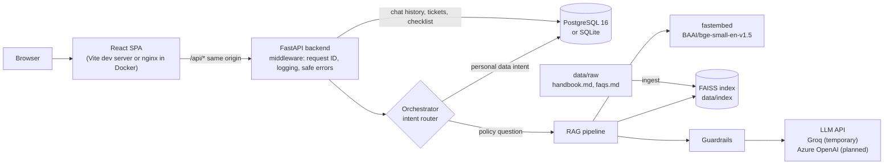
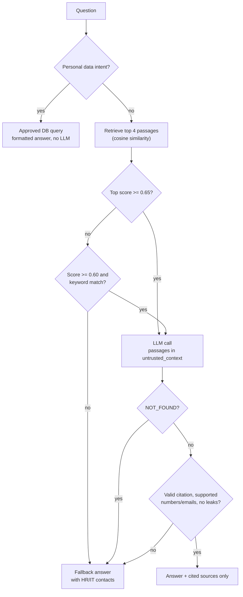

# Architecture: OnboardAI

Current architecture of the local implementation (21 November 2026). Azure components are planned, not implemented.

## System overview

## RAG decision flow

## Components

| Component | Location | Responsibility |
|---|---|---|
| Frontend | `frontend/src/` | Dashboard, AI Assistant, checklist, leave and payroll, assets, support tickets |
| API and middleware | `backend/main.py`, `backend/routes/`, `backend/middleware/` | Endpoints, validation, request IDs, logging, safe JSON errors |
| Orchestrator | `backend/services/orchestrator.py`, `employee_query_router.py` | Route personal questions to approved DB functions, others to RAG |
| Ingestion | `backend/services/ingest.py` | Section-aware chunking (350 words, 40 overlap), embedding, FAISS index |
| Retrieval | `backend/services/retriever.py`, `embeddings.py` | Local embeddings, top-k search |
| Guardrails | `backend/services/guardrails.py` | Retrieval gate, context sanitising, output validation, cited-source mapping |
| LLM client | `backend/services/llm.py` | OpenAI-compatible client (Groq temporarily), grounded system prompt |
| Persistence | `backend/services/db.py`, `employee_db.py` | Chat history, tickets, checklist, employee data (PostgreSQL or SQLite) |
| Containers | `Dockerfile`, `frontend/Dockerfile`, `docker-compose.yml` | Local frontend + backend + PostgreSQL stack |

## Deployment view (local Docker Compose)

- `frontend`: nginx on 127.0.0.1:8080, serves the build, proxies `/api/*` to `backend:8000`.
- `backend`: FastAPI on 127.0.0.1:8000, embedding model inside the image, FAISS index mounted read-only, logs on a named volume.
- `db`: PostgreSQL 16, named volume, initialised from `docker/postgres/`, not published to the host.
- Startup order via health checks; `restart: unless-stopped`.

## Planned Azure target (not implemented)

Azure OpenAI replaces Groq; hosting, managed PostgreSQL, secret storage (Key Vault / managed identity) and identity (for example Microsoft Entra ID) are to be confirmed once Azure access is available. See the migration section in the root [README](../README.md).

## Historical design

[architecture.png](architecture.png) shows the initial Day 31 design (Streamlit frontend, OpenAI, SQLite). It is superseded by the diagrams above and kept for reference only.
