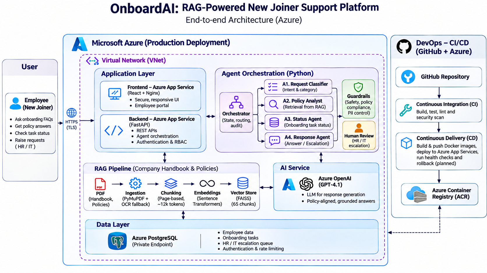
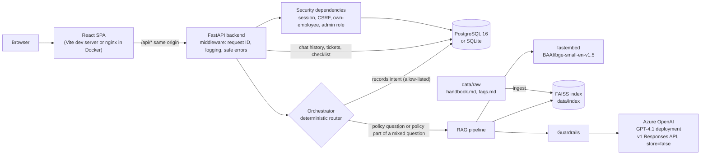
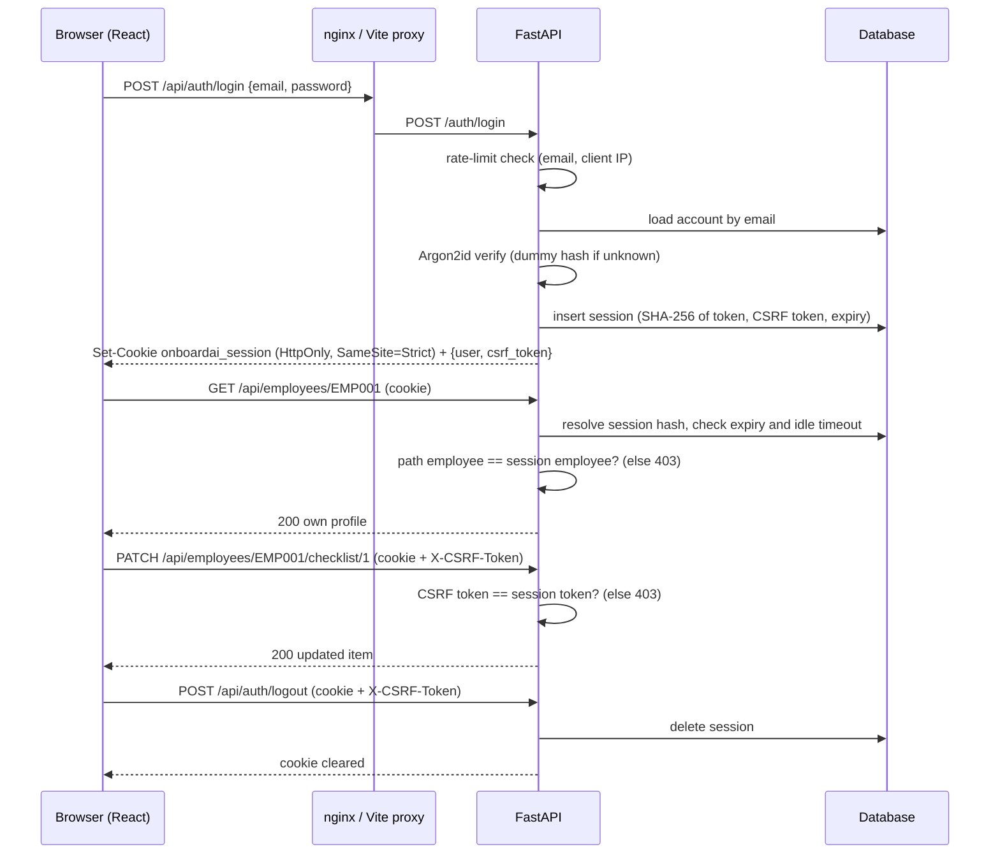
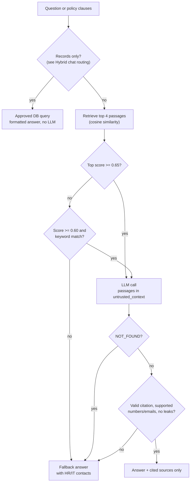
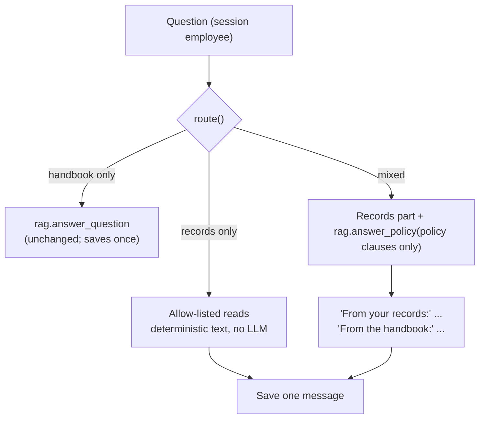
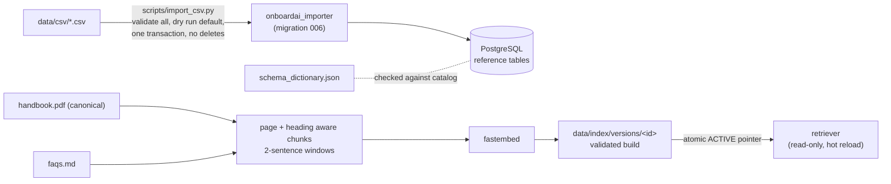
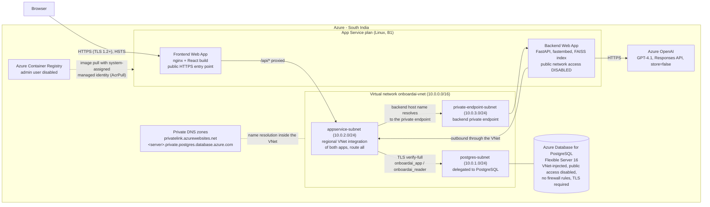

# Architecture: OnboardAI

Current architecture (updated 25 November 2026), including local email/password authentication. The application is deployed on Azure (App Service, private PostgreSQL Flexible Server, Azure OpenAI) and verified in production; see [Deployment view (Azure)](#deployment-view-azure). The local Docker Compose stack remains the development and rehearsal environment.

## Architecture overview

*Conceptual overview of the final solution (25 November 2026). The sections below are the authoritative technical reference: exact network isolation in [Deployment view (Azure)](#deployment-view-azure), the deterministic routing and RAG implementation in [Hybrid chat routing](#hybrid-chat-routing-phase-2) and [Data and knowledge ingestion](#data-and-knowledge-ingestion-m4), and the delivery pipeline in [Delivery pipeline (CI/CD)](#delivery-pipeline-cicd).*

## System overview

## Authentication and request authorization

- Identity always comes from the server-side session; employee IDs in requests are only compared against it.
- Session tokens are 256-bit random values; only their SHA-256 hash is stored. Sessions expire after `SESSION_TTL_MINUTES` (8 h) or `SESSION_IDLE_MINUTES` (60 min) of inactivity.
- Roles: `employee` (own records only) and `admin` (`/ingest`, legacy checklist; no employee data unless linked).

## RAG decision flow

## Hybrid chat routing (Phase 2)

`employee_query_router.route(question)` is deterministic (no LLM, no generated SQL). It splits the question into clauses only where a new question starts ("... and how many leaves do I have left"), classifies each clause, then merges the results.

| Rule | Condition (first match wins) | Result |
|---|---|---|
| P1 | A topic's own state cue: status, progress, pending, completed, balance, left, remaining, assigned, next payroll, ... | Records for that topic (+ handbook if the clause also has a policy cue) |
| P2 | Policy cue: policy, rules, entitled, eligible, per year, can I, how do I, do I get, need to, approve, ... | Handbook |
| P3 | First-person marker (my, I, me) + a personal topic (checklist, leave, assets, tickets, profile) | Records |
| P4 | Topic without any cue ("casual leaves") | Handbook (safe default, logged as ambiguous) |
| P5 | No topic | Handbook |

- A clause without a topic inherits the previous clause's topic ("what is the leave policy and how many do I have left").
- Payroll is company-wide: only "next / upcoming / calendar / pay date" questions read `payroll_calendar`; "when is salary credited" stays a handbook question.
- A records clause that refers to someone else (another employee ID, "Meera's", "does Meera have", "my colleague", "their") is refused without any query.
- Records reads use only the closed allow-list (`get_employee_checklist`, `get_leave_balances`, `get_employee_assets`, `get_employee_tickets`, `get_employee`, `get_payroll_calendar`) with the session employee, through the Phase 1 read-only path (reader role, signed employee scope, row-level security).

| Situation | Behaviour |
|---|---|
| Records missing | "No ... records were found." (`found=false` for that part); nothing is invented |
| Handbook evidence too weak or answer rejected by guardrails | Standard fallback text for the handbook part |
| LLM unavailable or retrieval error in a mixed question | Records part returned, handbook part replaced by "I could not check the handbook right now ..." (HTTP 200) |
| LLM unavailable in a handbook-only question | HTTP 503 as before, nothing saved |
| Database timeout in the records part | HTTP 503 (Phase 1 behaviour), nothing saved |
| Account without an employee workspace (admin) | Note instead of personal records; company payroll calendar and handbook part still answered |

Sources keep the existing `{file, section, score}` shape: records use `{"file": "Your records" or "Company records", "section": "Onboarding checklist" ..., "score": 1.0}`, handbook passages keep their file names. Only the policy clauses are sent to retrieval and the LLM; employee records are never sent to the LLM.

## Data and knowledge ingestion (M4)

- **CSV import** (`backend/services/csv_import.py`, `scripts/import_csv.py`): six reference tables in foreign-key order; header/type/allowed-value/foreign-key/duplicate validation of every file before any write; idempotent upserts on natural keys; never deletes; `checklist_assignments` insert-only. Runs only as `onboardai_importer` (INSERT/UPDATE on reference tables, no access to auth, chat, ticket or signing-key data); the app and reader roles gain no privileges.
- **Schema dictionary** (`backend/services/schema_dictionary.json`, `schema_dictionary.py`): tables, columns, PostgreSQL types, nullability, primary/unique/foreign keys, relationships and security flags; `introspect()` + `diff()` prove it matches the catalog (CI PostgreSQL job, `scripts/schema_dictionary.py --check`). It documents the approved query functions' data; it is not used to generate SQL.
- **PDF RAG** (`backend/services/ingest.py`): the handbook PDF is the canonical source (same-stem Markdown is a derived copy and is skipped; identical files are indexed once). Text is extracted per page, split at numbered headings accepted only in sequence, and chunked per section and page. Retrieval units are overlapping 2-sentence windows whose `context` is the whole section ("small-to-big"): focused facts are retrievable, the LLM still sees full sections, and each section is returned once. Citations keep the section labels; sources gain an optional `page` field.
- **Index lifecycle**: versioned builds, validation (counts, dimension, manifest, self-search), atomic activation through `ACTIVE`, previous version preserved on failure, three versions kept, legacy flat files still readable. The request path never builds or writes an index, so the read-only Docker mount is safe.

## Components

| Component | Location | Responsibility |
|---|---|---|
| Frontend | `frontend/src/` | Login page, dashboard, AI Assistant, checklist, leave and payroll, assets, support tickets; CSRF token kept in memory |
| API and middleware | `backend/main.py`, `backend/routes/`, `backend/middleware/` | Endpoints, validation, request IDs, logging, safe JSON errors |
| Orchestrator | `backend/services/orchestrator.py`, `employee_query_router.py` | Deterministic clause routing with precedence rules; records via the closed allow-list, policy via RAG, mixed questions composed into one answer and one saved message |
| Ingestion | `backend/services/ingest.py` | Canonical PDF (page + heading aware) and FAQ chunking, 2-sentence retrieval windows, embedding, versioned FAISS index with atomic activation |
| Retrieval | `backend/services/retriever.py`, `embeddings.py` | Local embeddings, top-k small-to-big search over the active index version (read-only, hot reload, last good version kept) |
| CSV import and schema dictionary | `backend/services/csv_import.py`, `scripts/import_csv.py`, `backend/services/schema_dictionary.py` + `.json`, `backend/migrations/006_import_role.py` | Validated idempotent HR data import as `onboardai_importer`; machine-readable schema checked against the catalog |
| Guardrails | `backend/services/guardrails.py` | Retrieval gate, injected-instruction screen for retrieved text, context sanitising, output validation, cited-source mapping |
| LLM client | `backend/services/llm.py` | Azure OpenAI GPT-4.1 deployment via the OpenAI SDK (v1 Responses API, `store=false`), grounded system prompt, fail-closed configuration, sanitised errors |
| Authentication | `backend/services/auth.py`, `auth_schema.py`, `backend/security.py`, `backend/routes/auth.py`, `backend/manage_accounts.py` | Argon2id passwords, server-side sessions, CSRF, login rate limiting, authorization dependencies, dev account provisioning |
| Persistence | `backend/services/db.py`, `employee_db.py` | Chat history, tickets, checklist, employee data, accounts and sessions (PostgreSQL or SQLite) |
| Read-only data access | `backend/services/readonly_query.py`, `postgres.py`, `employee_scope.py` | SQL-agent path: statements parsed with PostgreSQL's parser (pglast) and allow-listed (one SELECT; reader tables, functions, cast types), READ ONLY transactions, statement timeout, row limit; `onboardai_reader` role with row-level security bound to an HMAC-signed, connection-bound, expiring employee scope verified in the database |
| Database roles | `backend/services/db_roles.py`, `backend/migrations/005_least_privilege_roles.py` | Least-privilege `onboardai_app` / `onboardai_reader` roles, owner-only signing key (`onboardai_private`), `SECURITY DEFINER` scope verifier (`onboardai_rls`) and RLS policies (provisioning steps: [runbook section 9](runbook.md#9-database-roles-least-privilege)) |
| Containers | `Dockerfile`, `frontend/Dockerfile`, `docker-compose.yml` | Local frontend + backend + PostgreSQL stack |

## Deployment view (local Docker Compose, development)

- `frontend`: nginx on 127.0.0.1:8080, serves the build, proxies `/api/*` to `backend:8000`.
- `backend`: FastAPI on 127.0.0.1:8000, embedding model inside the image, FAISS index mounted read-only, logs on a named volume.
- `db`: PostgreSQL 16, named volume, initialised from `docker/postgres/` (schema, synthetic data, authentication tables; no accounts), not published to the host.
- The backend trusts `X-Forwarded-For`/`-Proto` from nginx (`TRUST_PROXY_HEADERS=true`) for login rate limiting and the cookie `Secure` flag.
- Startup order via health checks; `restart: unless-stopped`.

## Deployment view (Azure)

Deployed 25 November 2026 (region South India) and verified in production: 17/17 checks (8 public, 9 signed-in), grounded GPT-4.1 answer citing handbook.pdf page 3 in 4.2 s. Scripts and procedure: [deploy/azure/README.md](../deploy/azure/README.md).

| Layer | Deployed configuration |
|---|---|
| Ingress | Only the frontend is public (HTTPS only, TLS 1.2 minimum, HTTP/2, FTPS disabled). nginx serves the React build, sends HSTS/CSP/X-Frame-Options/nosniff, blocks `/api/docs`, and proxies `/api/*` to the backend. |
| Backend isolation | Backend `publicNetworkAccess = Disabled`: its main and SCM (Kudu) sites answer only through the private endpoint in `private-endpoint-subnet`; from the internet both return 403. The frontend reaches it over regional VNet integration (route all) and the private DNS zone `privatelink.azurewebsites.net`. |
| Database | PostgreSQL Flexible Server 16, VNet-injected in `postgres-subnet`, public access disabled, no firewall rules, `require_secure_transport=on`, TLS 1.2 minimum. The backend connects with TLS certificate and host-name verification as the least-privilege roles `onboardai_app` and `onboardai_reader` (row-level security with signed employee scope); the administrator login is not used by the application. |
| Images | Backend and frontend images in Azure Container Registry (admin user disabled), pulled by each Web App with its system-assigned managed identity (AcrPull). The FAISS index, handbook PDF and embedding model are inside the backend image. |
| Management plane | SCM/FTP basic (publishing-credential) authentication disabled on both apps; backend SCM site private only; frontend SCM site default deny. |
| Configuration and secrets | App settings of each Web App (encrypted at rest by App Service), set from an external secrets file that is never committed. Azure Key Vault references are a planned improvement. |
| Health | App Service health checks: backend `/ready` (database and index), frontend `/healthz`. |
| Data migration | One-time, inside the VNet, over an authenticated SSH tunnel to a temporary migration image; 12/12 table fingerprints identical; all temporary access removed afterwards (see project plan). |

### Delivery pipeline (CI/CD)

CI (`.github/workflows/ci.yml`) runs on every push and pull request. CD (`.github/workflows/cd.yml`) is implemented but **has not completed a release yet** (runs #1-#3 stopped safely before any production change; causes fixed); it is manual and approval-gated:

```mermaid
flowchart LR
    dev["Merge to main"] --> ci["CI: backend tests, live PostgreSQL<br/>security suite, frontend, Docker build"]
    ci -->|"success for this commit"| gate["CD gate<br/>main only, confirm=deploy"]
    gate --> build["Build job (no Azure access)<br/>rebuild + validate FAISS index,<br/>build images, smoke checks,<br/>separate Trivy scans:<br/>vulnerabilities + secrets"]
    build --> approve{"Environment 'production'<br/>required reviewer"}
    approve --> rel["Release job<br/>GitHub OIDC -> managed identity<br/>(AcrPush on ACR, Website Contributor<br/>on the two Web Apps only)"]
    rel --> push["Push immutable SHA tags,<br/>record digests"]
    push --> deploy["ARM: backend, then frontend<br/>sitecontainer image update"]
    deploy --> verify{"Health, unchanged config,<br/>8 public checks"}
    verify -->|"pass"| done["Release evidence<br/>(job summary)"]
    verify -->|"fail after an image update"| rb["Roll back both apps to the<br/>recorded images; verify images,<br/>configuration and health"]
```

The release identity has no database, network or resource-group permission, and the pipeline never uses the SCM/Kudu site, publish profiles or app-setting values. GitHub-hosted runners reach only the ARM API, the registry and the public frontend; the private backend endpoint and the private database are unchanged. Database migrations remain a manual in-VNet procedure.

Local email/password authentication is used in production as in development; an external identity provider (for example Microsoft Entra ID) is a possible later change, not current scope.

## Historical design

[architecture.png](architecture.png) shows the initial Day 31 design (Streamlit frontend, OpenAI, SQLite). It is superseded by the diagrams above and kept for reference only.
