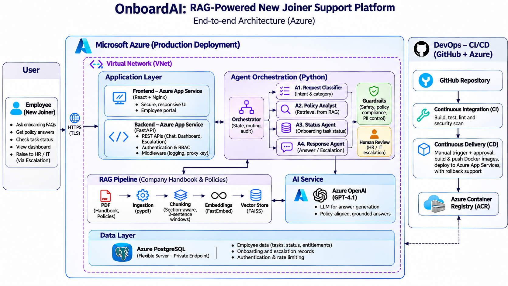

# OnboardAI: RAG-Powered New Joiner Support Platform

## End-to-end architecture

The platform uses a React and Nginx frontend, a private FastAPI backend, deterministic Python orchestration, FAISS retrieval, Azure OpenAI GPT-4.1 and Azure PostgreSQL. Chat requests reach RAG only through orchestration. Direct dashboard and escalation APIs do not use the LLM.

The approved PNG is a simplified logical overview. For precise implementation, use the request trace and Mermaid flow below: orchestration runs inside FastAPI; PostgreSQL uses a delegated subnet, not a private endpoint; the private endpoint belongs to the backend. App Services use outbound VNet integration rather than being hosted inside the VNet, and Azure OpenAI is reached over public HTTPS. HR/IT escalation is a separate user-initiated API. The A1–A4 labels describe logical responsibilities, not autonomous agents. The policy path alone invokes GPT-4.1. CI does not automatically trigger production CD; deployment requires a manual trigger and reviewer approval.

The following implementation details are based on the supplied source-code review of deployed commit `b81eff9`.

## 1. Chat request trace

| # | Hop | Evidence |
|---|---|---|
| 1 | React posts `POST /api/chat {employee_id, question}`; an axios interceptor adds `X-CSRF-Token` | `frontend/src/App.jsx:74` → `employeeApi.chat` in `frontend/src/api.js:76-77`; base URL `/api` at `api.js:6`; CSRF header at `api.js:18-19` |
| 2 | nginx strips `/api`, adds the proxy key and forwards over HTTPS to the backend through the private endpoint. `/api/docs`, `/api/redoc`, `/api/openapi.json` and `/api/ready` return 404 | `deploy/azure/nginx.conf.template:39-55` (rewrite :40, proxy_pass :41, `X-OnboardAI-Proxy-Key` :53); 404 rules :28-33 |
| 3 | FastAPI middleware: request ID/logging, and rejection of any request without the proxy key | `backend/middleware/__init__.py:20` (`RequestLoggingMiddleware`), `:80` (`ProxyKeyMiddleware`); installed at `backend/main.py:35` |
| 4 | Authentication: session cookie plus CSRF check | `backend/routes/chat.py:25`: `Depends(csrf_protected)` (`backend/security.py:73`) |
| 5 | Own-employee authorization | `chat.py:28-34`: `assert_own_employee` (`security.py:110`) |
| 6 | **The only orchestration entry point** | `chat.py:42`: `orchestrator.answer_question(...)` |
| 7 | Deterministic routing | `backend/services/orchestrator.py:258`: `employee_query_router.route()` (`employee_query_router.py:244`; rules P1–P5 at `:232-241`) |
| 8a | Handbook only → RAG, which saves the message itself | `orchestrator.py:263-267` → `rag.answer_question` (`rag.py:81`) → `answer_policy` (`rag.py:22`) |
| 8b | Records → closed allow-list reads | `orchestrator.py:269` → `_records_part` (`:190-218`) → `execute_employee_query` / `execute_company_query` (`employee_query_router.py:298-338`, `ALLOWED_OPERATIONS` / `COMPANY_OPERATIONS`) → `employee_db` → `readonly_query.fetch_readonly` (`employee_db.py:68-70`: reader role, READ ONLY transaction, SQL parsed by pglast, signed scope enforced by row-level security) |
| 8c | Mixed questions → records part plus handbook part | `orchestrator.py:271-275` → `_policy_part` (`:221-232`) → `rag.answer_policy`; an LLM outage degrades only the handbook part (`:226-231`) |
| 9 | Retrieval | `rag.py:30`: `retriever.search` (`retriever.py:61`) |
| 10 | Guardrails before the LLM | `rag.py:34`: `screen_passages` (`guardrails.py:115`); `rag.py:40`: `retrieval_gate` (`guardrails.py:48`); a failed gate returns the fallback with **no LLM call** (`rag.py:43-44`) |
| 11 | Azure OpenAI | `rag.py:49`: `llm.generate_answer` (`llm.py:99`) → `client.responses.create` (`llm.py:111`) with the deployment name as `model`, the system prompt as `instructions`, `temperature=0`, `max_output_tokens`, `store=False` |
| 12 | Guardrails after the LLM | `rag.py:52-63`: `NOT_FOUND` check, then `validate_answer` (`guardrails.py:207`: leaks, citations, unsupported facts); only cited sources are returned (`rag.py:66-67`) |
| 13 | Persistence, one saved answer per successful request | handbook path: `rag.py:93/102`; records and mixed paths: `orchestrator.py:279` `_save` (`:235`) → `db.save_employee_message` (`db.py:318`) or `db.save_message` (`db.py:236`) |
| 14 | Response `{message_id, answer, sources, found}` | `chat.py:77-85` |

## 2. Orchestration and Azure OpenAI call sites

- **Every authorized chat request that reaches answer generation goes through the orchestrator.** `/chat` is the only runtime caller of `orchestrator.answer_question` (`chat.py:42`).
- **Exactly one production call to Azure OpenAI:** `llm.py:111` (`client.responses.create`), reached only from `rag.py:49`.
- `rag.answer_policy` / `answer_question` are reached at runtime only from `orchestrator.py:225` and `:264`, plus `rag.py:87` (internal).
- **Nothing in production bypasses orchestration.** The scripts that call RAG or the LLM directly (`scripts/rag_eval.py:290,323,373,400,421`, `scripts/run_test_questions.py:36`) are offline evaluation tools. They aren't in the production image, which copies only `backend/`, `data/raw` and the index (`deploy/azure/backend.Dockerfile:24-36`).

## 3. Execution paths by question type

- **Policy question** → router finds no record intents → `rag.answer_question` → retrieve, screen, gate, GPT-4.1, validate → cited answer, or the fallback → saved.
- **Employee-record question** → router finds record intents (P1 or P3) → allow-listed database reads through the reader role with row-level security → formatted text → saved. **No LLM call.**
- **Mixed question** → records part plus `rag.answer_policy` on the policy clauses only → combined "From your records / From the handbook" answer → saved once. Employee records never reach the LLM.
- **Unsupported question:**
  - *Out of scope:* routed to RAG; the retrieval gate fails (no LLM call), or the model returns `NOT_FOUND`, or validation rejects the answer → `FALLBACK` (`rag.py:43-63`).
  - *About another employee:* the router flags it as third party (`employee_query_router.py:229`) → `THIRD_PARTY_REFUSAL` with **no query run** (`orchestrator.py:193-194`).
- **HR/IT escalation is not part of chat or the orchestrator.** It's a separate, user-initiated action: the UI's "Escalate to HR/IT" button (`App.jsx:43-45`) calls `POST /escalate` (`backend/routes/feedback.py:28-37` → `db.add_escalation`, `db.py:297`). HR staff then work the queue through `/hr/escalations` (`backend/routes/hr.py:33-61`), which requires the `hr` role (`security.py:85,92`) and is **API-only, with no UI**.

## 4. Logical agent responsibilities (A1–A4)

**They aren't separately implemented agents.** The repository has 0 agent classes or modules, and the router makes **no LLM calls**. The "SQL agent" term in config and comments names the read-only, allow-listed data path; the LLM never generates SQL.

| Diagram label | Actual implementation |
|---|---|
| A1 Request Classifier | `employee_query_router.route` / `classify_clause`: deterministic rules P1–P5 |
| A2 Policy Analyst | `rag.answer_policy`: retrieval, guardrails, GPT-4.1 |
| A3 Status Agent | `_records_part` plus the `ALLOWED_OPERATIONS` / `COMPANY_OPERATIONS` reads |
| A4 Response Agent | `orchestrator.answer_question` composition (`:269-287`) plus `_save` |

## 5. Direct dashboard APIs versus orchestrated chat

| Direct REST APIs (no orchestrator, no LLM) | Orchestrated |
|---|---|
| `/employees/{id}` profile, leave balances, assets, checklist (GET and PATCH), tickets (GET and POST), `/employees/payroll/calendar` → `employee_db` (`backend/routes/employees.py:34-154`) | `POST /chat` only |
| `/feedback`, `/escalate` (`feedback.py`), `/hr/escalations*` (`hr.py`), `/history` (`chat.py:88`), `/auth/*`, `/ingest` (admin, `backend/routes/admin.py:16-29`), legacy `/checklist`, `/health`, `/ready` | — |

## 6. Ingestion, retrieval, network and CI/CD

- **Ingestion:** `pypdf.PdfReader`, text extracted per page (`ingest.py:131-133`, `chunk_pdf` :136). The PDF is canonical, so the same-named Markdown copy is skipped (`:189-195`).
- **Chunking:** sections are split at numbered headings, with a 350-word / 40-overlap split for long sections (`_split_long` :54). They are then cut into **2-sentence windows** (`WINDOW_SENTENCES = 2` :68, `with_windows` :71-88) that keep the whole section as context; each FAQ is one chunk. The current index has 65 chunks.
- **Embeddings:** `fastembed.TextEmbedding` with `BAAI/bge-small-en-v1.5`, L2-normalised (`embeddings.py:12-23`).
- **FAISS:** `faiss.IndexFlatIP` with normalised vectors, so inner product equals cosine similarity (`ingest.py:280-281`). Builds are versioned under `ACTIVE` + `versions/`, 3 versions are kept, and activation is atomic (:36-41).
- **Retrieval:** "small-to-big" search: matches windows with `top_k × 6` candidates, then returns each parent section once (`retriever.py:61-77`). Top-k is 4; the gate is 0.65, with a 0.60–0.65 band that needs keyword corroboration.
- **Azure network**, from the deploy scripts and verified live in Azure:
  - **Frontend:** a public Web App, VNet-integrated with route-all.
  - **Backend:** a Web App with public access Disabled, reachable only through a private endpoint, with private DNS `privatelink.azurewebsites.net`.
  - **PostgreSQL:** VNet-injected in `postgres-subnet` with private DNS, public access disabled, TLS verify-full.
  - **Images:** pulled from ACR with managed identities (AcrPull).
  - **LLM:** Azure OpenAI over a public HTTPS endpoint.
- **CI/CD:**
  - **CI** (`ci.yml`), on every push and PR, with 4 jobs: backend, live PostgreSQL security suite, frontend, Docker build. Required on `main` by branch protection.
  - **CD** (`cd.yml`) is manual (`workflow_dispatch`), with three jobs:
    1. **Gate:** `main` only, CI passed for the commit, protected environment.
    2. **Build:** no Azure access; index rebuild and validation, image build, smoke checks, Trivy vulnerability and secret scans.
    3. **Release:** reviewer approval, then OIDC sign-in as a managed identity, push to ACR, ARM deploy of backend then frontend, health and digest checks, configuration comparison, 8 public checks, and automatic rollback on failure.

## 7. Detailed implementation flow (Mermaid)

```mermaid
flowchart LR
    user["Employee browser"] -->|"HTTPS"| fe

    subgraph gh["GitHub"]
        repo["Repository"] --> ci["CI (ci.yml): backend, PostgreSQL security,<br/>frontend, Docker build"]
        ci -->|"green on main"| cd["CD (cd.yml, manual)<br/>gate -> build + index validation + Trivy<br/>-> reviewer approval -> release"]
    end

    subgraph az["Azure (South India)"]
        fe["Frontend Web App (public)<br/>nginx + React; /api proxy + proxy key;<br/>docs and /ready blocked"]
        subgraph vnet["VNet"]
            pe["Private endpoint<br/>(privatelink.azurewebsites.net)"]
            subgraph be["Backend Web App (public access disabled)"]
                mw["Middleware: request ID, proxy-key check"] --> authn["Session + CSRF + own-employee checks"]
                authn --> chat["POST /chat"]
                authn --> rest["Direct REST APIs: profile, leave, assets,<br/>checklist, tickets, payroll, history,<br/>feedback, /escalate, /hr/escalations"]
                chat --> orch["orchestrator.answer_question"]
                orch --> router["employee_query_router.route<br/>(deterministic P1-P5, no LLM)"]
                router -->|"records intents"| recs["_records_part: allow-listed reads<br/>(third-party -> refusal, no query)"]
                router -->|"handbook / mixed policy clauses"| rag["rag.answer_policy"]
                rag --> ret["retriever.search: fastembed bge-small,<br/>FAISS IndexFlatIP, top-4 small-to-big"]
                ret --> g1["Guardrails: injection screen,<br/>retrieval gate 0.65 (fallback, no LLM)"]
                g1 --> llmc["llm.generate_answer<br/>(Responses API, store=false)"]
                llmc --> g2["Guardrails: NOT_FOUND, leaks,<br/>citations, unsupported facts"]
                recs --> compose["Compose answer + save once"]
                g2 --> compose
            end
            pg[("PostgreSQL 16 Flexible Server<br/>VNet-injected, TLS verify-full<br/>app + reader roles, RLS signed scope")]
        end
        acr["Azure Container Registry<br/>(admin disabled)"]
        aoai["Azure OpenAI<br/>GPT-4.1 deployment"]
    end

    fe -->|"VNet integration"| pe --> mw
    recs -->|"READ ONLY, reader role"| pg
    rest --> pg
    compose -->|"chat history"| pg
    llmc -->|"HTTPS, passages + question only"| aoai
    cd -->|"OIDC managed identity: AcrPush"| acr
    cd -->|"ARM sitecontainer update (Website Contributor)"| be
    cd -->|"ARM sitecontainer update"| fe
    acr -.->|"managed-identity pull"| be
    acr -.->|"managed-identity pull"| fe
    pdf["data/raw: handbook.pdf + faqs.md"] -->|"pypdf, 2-sentence windows,<br/>built in CD, baked into image"| ret
```

