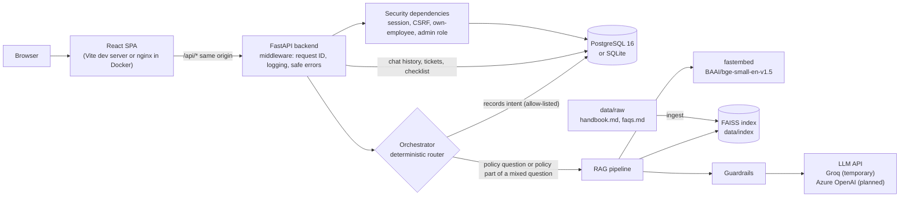
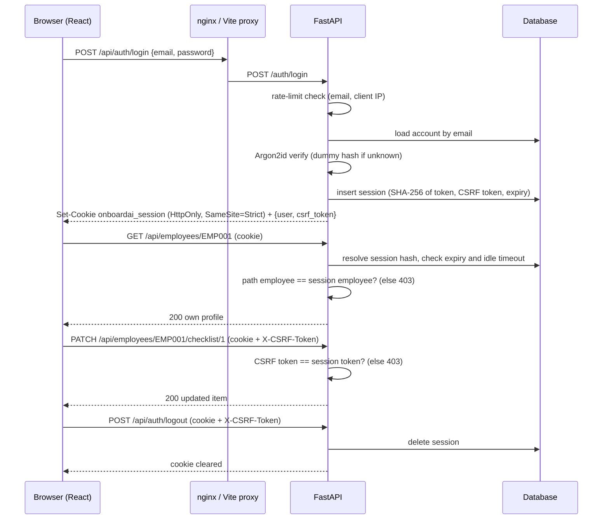
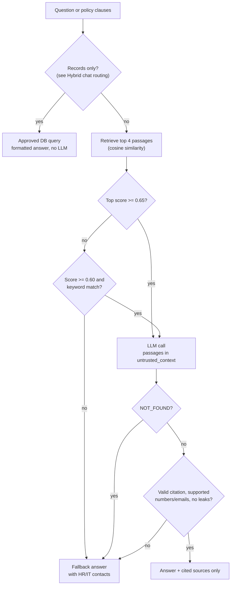
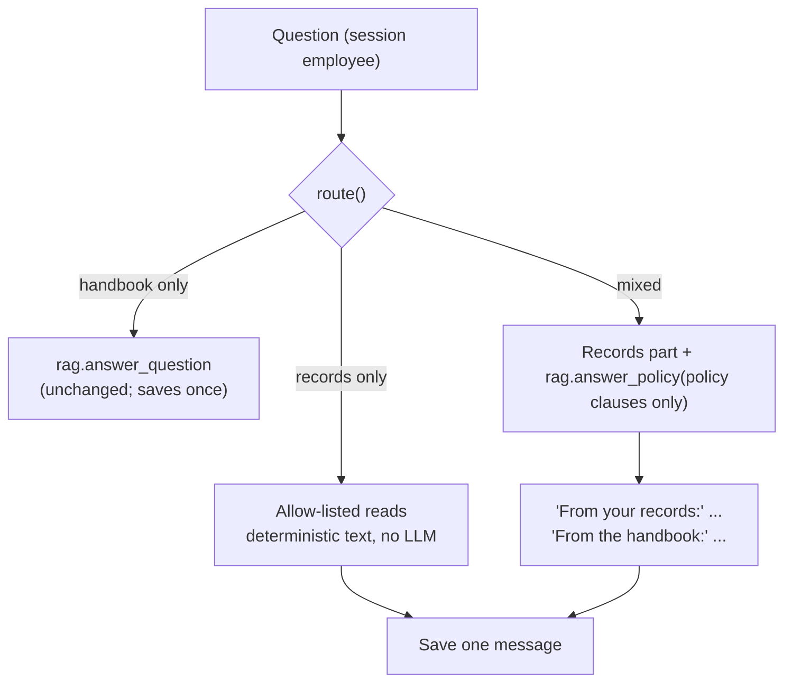

# Architecture: OnboardAI

Current architecture of the local implementation (updated 23 November 2026), including local email/password authentication. Azure components are planned, not implemented.

## System overview

## Authentication and request authorization

- Identity always comes from the server-side session; employee IDs in requests are only compared against it.
- Session tokens are 256-bit random values; only their SHA-256 hash is stored. Sessions expire after `SESSION_TTL_MINUTES` (8 h) or `SESSION_IDLE_MINUTES` (60 min) of inactivity.
- Roles: `employee` (own records only) and `admin` (`/ingest`, legacy checklist; no employee data unless linked).

## RAG decision flow

## Hybrid chat routing (Phase 2)

`employee_query_router.route(question)` is deterministic (no LLM, no generated SQL). It splits the question into clauses only where a new question starts ("... and how many leaves do I have left"), classifies each clause, then merges the results.

| Rule | Condition (first match wins) | Result |
|---|---|---|
| P1 | A topic's own state cue: status, progress, pending, completed, balance, left, remaining, assigned, next payroll, ... | Records for that topic (+ handbook if the clause also has a policy cue) |
| P2 | Policy cue: policy, rules, entitled, eligible, per year, can I, how do I, do I get, need to, approve, ... | Handbook |
| P3 | First-person marker (my, I, me) + a personal topic (checklist, leave, assets, tickets, profile) | Records |
| P4 | Topic without any cue ("casual leaves") | Handbook (safe default, logged as ambiguous) |
| P5 | No topic | Handbook |

- A clause without a topic inherits the previous clause's topic ("what is the leave policy and how many do I have left").
- Payroll is company-wide: only "next / upcoming / calendar / pay date" questions read `payroll_calendar`; "when is salary credited" stays a handbook question.
- A records clause that refers to someone else (another employee ID, "Meera's", "does Meera have", "my colleague", "their") is refused without any query.
- Records reads use only the closed allow-list (`get_employee_checklist`, `get_leave_balances`, `get_employee_assets`, `get_employee_tickets`, `get_employee`, `get_payroll_calendar`) with the session employee, through the Phase 1 read-only path (reader role, signed employee scope, row-level security).

| Situation | Behaviour |
|---|---|
| Records missing | "No ... records were found." (`found=false` for that part); nothing is invented |
| Handbook evidence too weak or answer rejected by guardrails | Standard fallback text for the handbook part |
| LLM unavailable or retrieval error in a mixed question | Records part returned, handbook part replaced by "I could not check the handbook right now ..." (HTTP 200) |
| LLM unavailable in a handbook-only question | HTTP 503 as before, nothing saved |
| Database timeout in the records part | HTTP 503 (Phase 1 behaviour), nothing saved |
| Account without an employee workspace (admin) | Note instead of personal records; company payroll calendar and handbook part still answered |

Sources keep the existing `{file, section, score}` shape: records use `{"file": "Your records" or "Company records", "section": "Onboarding checklist" ..., "score": 1.0}`, handbook passages keep their file names. Only the policy clauses are sent to retrieval and the LLM; employee records are never sent to the LLM.

## Components

| Component | Location | Responsibility |
|---|---|---|
| Frontend | `frontend/src/` | Login page, dashboard, AI Assistant, checklist, leave and payroll, assets, support tickets; CSRF token kept in memory |
| API and middleware | `backend/main.py`, `backend/routes/`, `backend/middleware/` | Endpoints, validation, request IDs, logging, safe JSON errors |
| Orchestrator | `backend/services/orchestrator.py`, `employee_query_router.py` | Deterministic clause routing with precedence rules; records via the closed allow-list, policy via RAG, mixed questions composed into one answer and one saved message |
| Ingestion | `backend/services/ingest.py` | Section-aware chunking (350 words, 40 overlap), embedding, FAISS index |
| Retrieval | `backend/services/retriever.py`, `embeddings.py` | Local embeddings, top-k search |
| Guardrails | `backend/services/guardrails.py` | Retrieval gate, context sanitising, output validation, cited-source mapping |
| LLM client | `backend/services/llm.py` | OpenAI-compatible client (Groq temporarily), grounded system prompt |
| Authentication | `backend/services/auth.py`, `auth_schema.py`, `backend/security.py`, `backend/routes/auth.py`, `backend/manage_accounts.py` | Argon2id passwords, server-side sessions, CSRF, login rate limiting, authorization dependencies, dev account provisioning |
| Persistence | `backend/services/db.py`, `employee_db.py` | Chat history, tickets, checklist, employee data, accounts and sessions (PostgreSQL or SQLite) |
| Read-only data access | `backend/services/readonly_query.py`, `postgres.py`, `employee_scope.py` | SQL-agent path: statements parsed with PostgreSQL's parser (pglast) and allow-listed (one SELECT; reader tables, functions, cast types), READ ONLY transactions, statement timeout, row limit; `onboardai_reader` role with row-level security bound to an HMAC-signed, connection-bound, expiring employee scope verified in the database |
| Database roles | `backend/services/db_roles.py`, `backend/migrations/005_least_privilege_roles.py` | Least-privilege `onboardai_app` / `onboardai_reader` roles, owner-only signing key (`onboardai_private`), `SECURITY DEFINER` scope verifier (`onboardai_rls`) and RLS policies (provisioning steps: [runbook section 9](runbook.md#9-database-roles-least-privilege)) |
| Containers | `Dockerfile`, `frontend/Dockerfile`, `docker-compose.yml` | Local frontend + backend + PostgreSQL stack |

## Deployment view (local Docker Compose)

- `frontend`: nginx on 127.0.0.1:8080, serves the build, proxies `/api/*` to `backend:8000`.
- `backend`: FastAPI on 127.0.0.1:8000, embedding model inside the image, FAISS index mounted read-only, logs on a named volume.
- `db`: PostgreSQL 16, named volume, initialised from `docker/postgres/` (schema, synthetic data, authentication tables; no accounts), not published to the host.
- The backend trusts `X-Forwarded-For`/`-Proto` from nginx (`TRUST_PROXY_HEADERS=true`) for login rate limiting and the cookie `Secure` flag.
- Startup order via health checks; `restart: unless-stopped`.

## Planned Azure target (not implemented)

Azure OpenAI replaces Groq; hosting, managed PostgreSQL, HTTPS and secret storage (Key Vault / managed identity) are to be confirmed once Azure access is available. Local email/password authentication is implemented; an external identity provider (for example Microsoft Entra ID) is a possible later change, not current scope. See the migration section in the root [README](../README.md).

## Historical design

[architecture.png](architecture.png) shows the initial Day 31 design (Streamlit frontend, OpenAI, SQLite). It is superseded by the diagrams above and kept for reference only.
