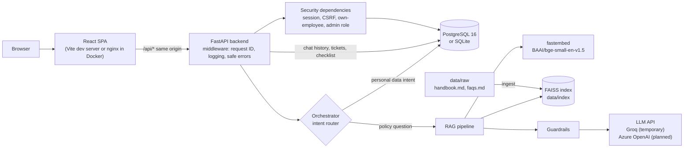
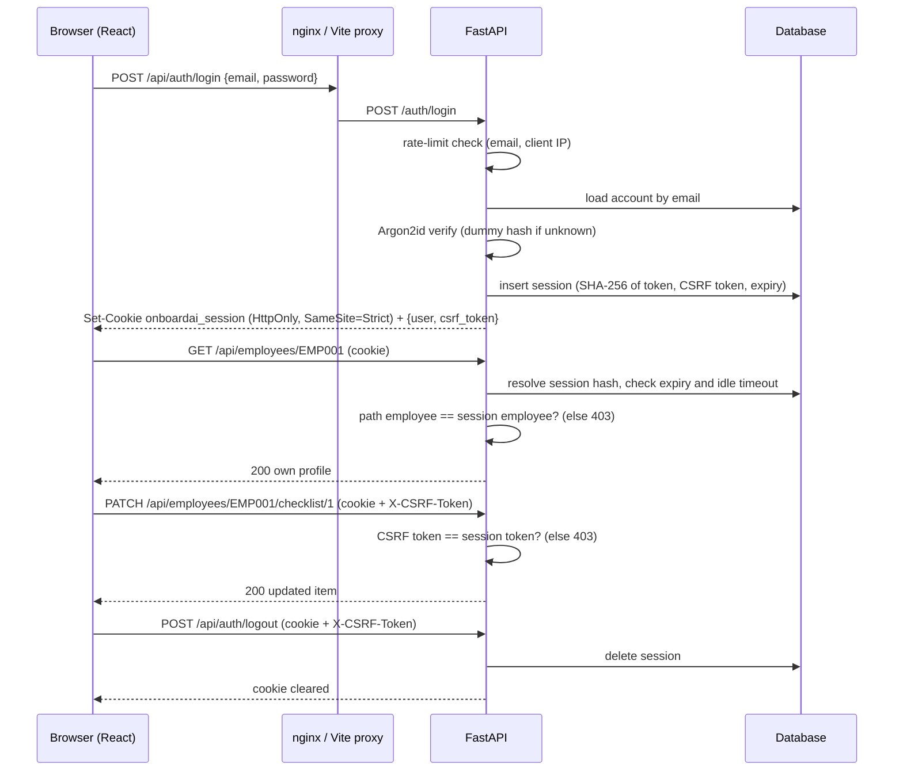
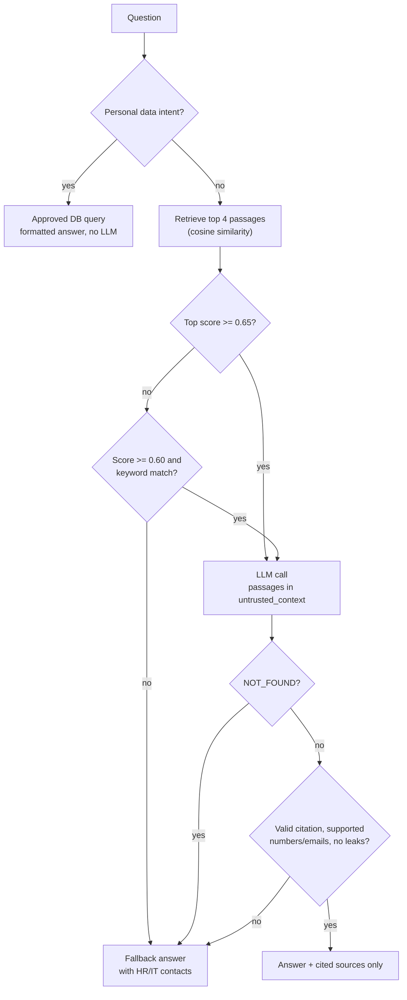

# Architecture: OnboardAI

Current architecture of the local implementation (21 November 2026), including local email/password authentication. Azure components are planned, not implemented.

## System overview

## Authentication and request authorization

- Identity always comes from the server-side session; employee IDs in requests are only compared against it.
- Session tokens are 256-bit random values; only their SHA-256 hash is stored. Sessions expire after `SESSION_TTL_MINUTES` (8 h) or `SESSION_IDLE_MINUTES` (60 min) of inactivity.
- Roles: `employee` (own records only) and `admin` (`/ingest`, legacy checklist; no employee data unless linked).

## RAG decision flow

## Components

| Component | Location | Responsibility |
|---|---|---|
| Frontend | `frontend/src/` | Login page, dashboard, AI Assistant, checklist, leave and payroll, assets, support tickets; CSRF token kept in memory |
| API and middleware | `backend/main.py`, `backend/routes/`, `backend/middleware/` | Endpoints, validation, request IDs, logging, safe JSON errors |
| Orchestrator | `backend/services/orchestrator.py`, `employee_query_router.py` | Route personal questions to approved DB functions, others to RAG |
| Ingestion | `backend/services/ingest.py` | Section-aware chunking (350 words, 40 overlap), embedding, FAISS index |
| Retrieval | `backend/services/retriever.py`, `embeddings.py` | Local embeddings, top-k search |
| Guardrails | `backend/services/guardrails.py` | Retrieval gate, context sanitising, output validation, cited-source mapping |
| LLM client | `backend/services/llm.py` | OpenAI-compatible client (Groq temporarily), grounded system prompt |
| Authentication | `backend/services/auth.py`, `auth_schema.py`, `backend/security.py`, `backend/routes/auth.py`, `backend/manage_accounts.py` | Argon2id passwords, server-side sessions, CSRF, login rate limiting, authorization dependencies, dev account provisioning |
| Persistence | `backend/services/db.py`, `employee_db.py` | Chat history, tickets, checklist, employee data, accounts and sessions (PostgreSQL or SQLite) |
| Containers | `Dockerfile`, `frontend/Dockerfile`, `docker-compose.yml` | Local frontend + backend + PostgreSQL stack |

## Deployment view (local Docker Compose)

- `frontend`: nginx on 127.0.0.1:8080, serves the build, proxies `/api/*` to `backend:8000`.
- `backend`: FastAPI on 127.0.0.1:8000, embedding model inside the image, FAISS index mounted read-only, logs on a named volume.
- `db`: PostgreSQL 16, named volume, initialised from `docker/postgres/` (schema, synthetic data, authentication tables; no accounts), not published to the host.
- The backend trusts `X-Forwarded-For`/`-Proto` from nginx (`TRUST_PROXY_HEADERS=true`) for login rate limiting and the cookie `Secure` flag.
- Startup order via health checks; `restart: unless-stopped`.

## Planned Azure target (not implemented)

Azure OpenAI replaces Groq; hosting, managed PostgreSQL, HTTPS and secret storage (Key Vault / managed identity) are to be confirmed once Azure access is available. Local email/password authentication is implemented; an external identity provider (for example Microsoft Entra ID) is a possible later change, not current scope. See the migration section in the root [README](../README.md).

## Historical design

[architecture.png](architecture.png) shows the initial Day 31 design (Streamlit frontend, OpenAI, SQLite). It is superseded by the diagrams above and kept for reference only.
